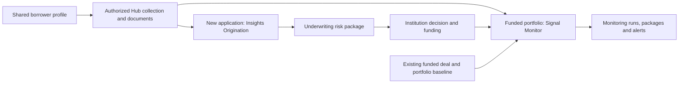

AMLOK helps financial institutions underwrite business and consumer borrowers with **Insights** and monitor funded deals with **Signal**. Borrowers connect their sources through an embedded Integrations Hub. Your institution submits its application, lending product and risk policy; AMLOK returns a risk package and the evidence behind it.

**One API covers the complete borrower-to-monitoring journey in 67 operations.** Use the [quickstart](/api-reference/quickstart), [endpoint reference](/api-reference/endpoints/insights/create-origination) and [OpenAPI download](/openapi/amlok.json).

## The integration flow

AMLOK handles collection, normalization, KYB/KYC, included checks and calculations. You do not orchestrate provider sync jobs, verification jobs, manifests or workflow runs. You can retrieve authorized normalized records, licensed reports and documents through the [Data API](/api-reference/data-access), evidence and download interfaces.

## Public resources

| Resource | What you use it for |
| --- | --- |
| Borrowers and embedding sessions | Identify the borrower and launch an authorized connection journey |
| Connections and consents | Inspect source access, freshness and required borrower actions |
| Lending-product and risk-policy versions | Supply the exact lending context for each assessment |
| Originations and risk packages | Request underwriting and retrieve dimensions, findings and evidence |
| Monitors, monitoring runs and alerts | Follow funded exposures, refreshed evidence and material changes |
| Data, evidence, documents and exports | Retrieve all collected/enriched data or inspect the exact inputs to an assessment |
| Events and webhook deliveries | Receive notifications, recover missed events and troubleshoot delivery |
| Billing summary, payments, usage and transactions | Reconcile top-ups, available credit and the exact product consumption behind each deduction |

The organization owns billing identity, payment methods and team roles. Each workspace has a shared CAD wallet and isolated Sandbox and Live environments. API keys are scoped to one workspace and environment. Historical assessments and evidence are immutable. Current borrower identity and monitoring configuration have explicit, versioned updates; see [borrower lifecycle](/api-reference/borrower-lifecycle).

<Columns cols={2}>
<Card title="Start integrating" icon="terminal" href="/api-reference/quickstart">Connect a borrower and submit an Origination.</Card>
<Card title="Read a risk package" icon="file-search" href="/api-reference/risk-package">Understand financial dimensions and exact evidence versions.</Card>
<Card title="Monitor funded deals" icon="activity" href="/api-reference/monitoring-design">Inspect evaluations, alerts and connection health.</Card>
<Card title="Explore the evidence" icon="database" href="/api-reference/evidence-traceability">Retrieve normalized data and authorized source files.</Card>
</Columns>

Use the [OpenAPI specification](/overview/openapi-spec) as the authoritative API contract.

<Tip>Follow the [runnable integration example](/api-reference/runnable-example) for a complete business or consumer journey, from borrower authorization to underwriting, monitoring and billing reconciliation.</Tip>
