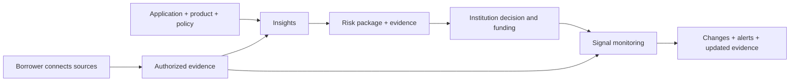

AMLOK serves financial institutions that underwrite and fund businesses or consumers. Borrowers connect authorized data sources through an embedded Integrations Hub. AMLOK normalizes that evidence and uses it for two products:

- **Insights:** assess an origination using the institution's application, lending product and risk policy. Return the financial dimensions, findings and evidence needed for the institution's decision.
- **Signal:** monitor an existing exposure, identify meaningful changes and deliver risk signals with their supporting evidence.

AMLOK supplies risk intelligence. Your institution makes lending decisions, funds deals and performs servicing in its own systems.

## Choose the correct contract

| Reference | Status | Use |
| --- | --- | --- |
| [Current API 1.4.2](/openapi/amlok-v1.json) | Existing published contract, 192 operations | Existing integrations, endpoint pages, SDKs and runnable examples |
| [Product API design](/api-reference/product-api-design) | Proposed replacement, 45 operations | Implementation planning and contract review; these `/v2` routes are **not available** |

The [API review](/api-reference/api-review) explains the consolidation. Publishing this documentation does not deploy backend routes, remove current endpoints or change existing client behavior. No replacement release date or v1 retirement date is established here.

## The customer journey

The replacement design makes this journey the public boundary. Collection, normalization, KYB/KYC stages, calculations, evidence freezing and orchestration run behind it. Your institution can still inspect every authorized supporting record, licensed report and retained file through a common evidence interface.

<CardGroup cols={2}>
  <Card title="Integrate with the current API" icon="terminal" href="/api-reference/quickstart">Use v1 connection, workflow and monitoring operations.</Card>
  <Card title="Review the product API" icon="blocks" href="/api-reference/product-api-design">See borrower sessions, Origination inputs and the smaller proposed surface.</Card>
  <Card title="Understand a risk package" icon="file-search" href="/api-reference/risk-package">Review dimensions, policy results, source coverage and evidence.</Card>
  <Card title="Understand monitoring" icon="activity" href="/api-reference/monitoring-design">Follow evaluations, risk alerts and reliable delivery.</Card>
</CardGroup>

## Workspace and access

Each server-side key is bound to one institution, workspace and environment. Never place it in borrower-facing code. A resource ID grants no access by itself; all reads, linked records, exports and downloads must enforce the same boundary. Sandbox and Live data remain isolated.

The organization owns its billing profile and team permissions. A workspace has one credit balance shared by Insights and Signal. Billing APIs are read-only reporting; authorized Owners manage funding and payment settings in the console. See [authentication](/api-reference/authentication), [product scope](/api-reference/products-and-endpoints) and [credit reporting](/api-reference/credit-reporting).

## Availability and versions

The existing reference is **API 1.4.2**, using `/v1`. Configure `AMLOK_API_BASE_URL` with your institution-issued environment URL. The separate design uses `/v2` to make its breaking changes explicit; it does not imply that a v2 service exists.

Provider access and fields depend on the [integration status catalog](/integrations/status), consent, market, enabled products and source entitlements. Missing or restricted evidence must remain explicit. Neither a connection nor a completed assessment guarantees a particular score, approval or data field.
