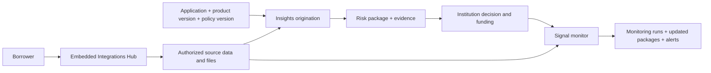

AMLOK helps financial institutions underwrite business and consumer borrowers with **Insights** and monitor funded deals with **Signal**. Borrowers connect their sources through an embedded Integrations Hub. Your institution submits its application, lending product and risk policy; AMLOK returns a risk package and the evidence behind it.

**API 2.0.0 is the primary reference.** Its 45 operations replace the previous 192-operation public contract. Use the [quickstart](/api-reference/quickstart), [endpoint reference](/api-reference/endpoints/insights/create-origination) and [OpenAPI download](/openapi/amlok-v2.json).

## The integration flow

AMLOK handles collection, normalization, KYB/KYC, included checks and calculations. You do not orchestrate provider sync jobs, verification jobs, manifests or workflow runs. You can retrieve authorized normalized records, licensed reports and documents through the evidence and download interfaces.

## Public resources

| Resource | What you use it for |
| --- | --- |
| Borrowers and embedding sessions | Identify the borrower and launch an authorized connection journey |
| Connections and consents | Inspect source access, freshness and required borrower actions |
| Lending-product and risk-policy versions | Supply the exact lending context for each assessment |
| Originations and risk packages | Request underwriting and retrieve dimensions, findings and evidence |
| Monitors, monitoring runs and alerts | Follow funded exposures, refreshed evidence and material changes |
| Evidence, documents and exports | Inspect or download the underlying authorized records and files |
| Events and webhook deliveries | Receive notifications, recover missed events and troubleshoot delivery |
| Billing summary and transactions | Read the shared wallet and immutable financial history |

The organization owns billing identity, payment methods and team roles. Each workspace has a shared CAD wallet and isolated Sandbox and Live environments. API keys are scoped to one workspace and environment. Product records cannot be edited or deleted; authorized configuration changes apply prospectively.

<Columns cols={2}>
<Card title="Start integrating" icon="terminal" href="/api-reference/quickstart">Connect a borrower and submit an Origination.</Card>
<Card title="Read a risk package" icon="file-search" href="/api-reference/risk-package">Understand financial dimensions and exact evidence versions.</Card>
<Card title="Monitor funded deals" icon="activity" href="/api-reference/monitoring-design">Inspect evaluations, alerts and connection health.</Card>
<Card title="Migrate from v1" icon="route" href="/api-reference/product-api-migration">Map every former operation to its v2 destination.</Card>
</Columns>

See [versioning and environment enablement](/api-reference/versioning) before switching an existing integration. The documentation contract and deployment of a backend environment are separate.
