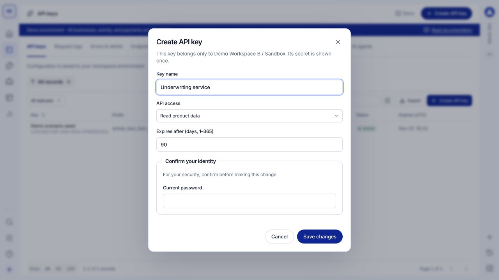

An API key gives your server access to the selected workspace environment. Create keys in **Dev Tools > API keys** as an Owner or Developer. A Sandbox key does not grant access to Live data.

## Create a key

<Steps>
  <Step title="Confirm the context">
    Check the workspace profile and environment banner. Choose a name that identifies the service or integration using the key.
  </Step>
  <Step title="Choose access and expiration">
    Select **Create API key**. Enter the key name, choose an **API access** profile and set its expiration. The form defaults to 90 days and accepts 1 to 365 days.

    Profiles include **Read product data**, **Origination integration** and **Monitoring integration**. **Billing reports** is available to Owners. Choose the access your service actually needs.
  </Step>
  <Step title="Confirm your identity">
    Complete the requested password, recent provider sign-in or MFA check. These checks protect credential creation and other sensitive settings.
  </Step>
  <Step title="Save the credential securely">
    Copy the new secret when it is shown. Store it in your server's secret manager. The full secret is shown once; the key list displays identifying metadata rather than a recoverable secret.
  </Step>
</Steps>

<Frame caption="Create a key for a named service and choose its access profile. This screenshot contains no credential.">
  
</Frame>

Never put a workspace API key in a browser, mobile bundle, screenshot or support message. Use the [authentication reference](/api-reference/authentication) for the request header and environment rules.

## Inspect and replace a key

Open a key record to inspect its name, prefix, access and expiration. Match request activity to the key's identifying metadata when investigating a service.

To replace a credential, create a new key, update your server's stored secret and verify a successful request. Then revoke the previous key. Revocation prevents further use; it does not erase historical requests.

## Use developer resources

**Dev Tools > SDKs and integrations** provides Node.js and cURL examples plus links to implementation guides. Copy an example into your server-side project and supply your own environment URL and securely stored key. Copying a template does not send a request.

**AI agents** provides integration context you can give a coding assistant, including the API contract, credential handling and event-verification rules. Use it as implementation guidance; inspect actual records in the relevant console views.

## Troubleshoot authorization

- **Authentication fails:** confirm the secret, expiration and selected environment.
- **A specific operation is forbidden:** compare the operation's required scope with the key's access profile.
- **Creation is unavailable:** confirm your role, recent sign-in and any required authenticator setup.

Use [Data Lookup](/console/data-lookup) to understand a payload, [Sandbox scenarios](/console/sandbox) to exercise outcomes and [request logs](/console/request-logs) to verify what reached AMLOK.
