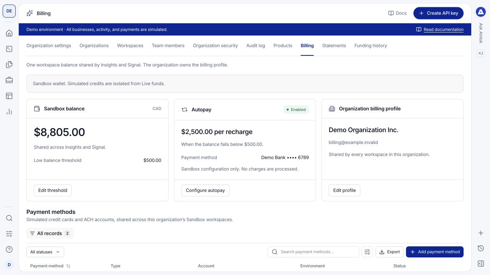
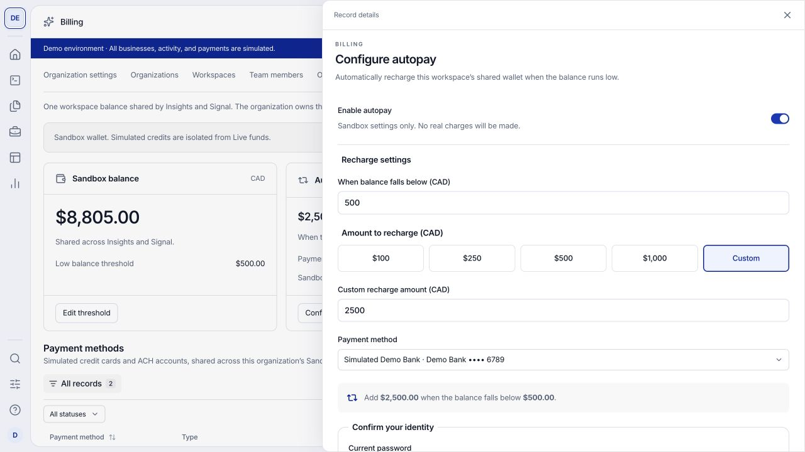

Owners use **Billing** to understand what was funded and how credits were consumed. Each workspace environment has a CAD balance shared by Insights and Signal. The organization owns the billing profile.

Sandbox uses simulated credits and payment records. It never charges a real card, debits a bank account or transfers funds. Screenshots in this guide show the demonstration dataset.

## Read the billing overview

Open workspace settings and select **Billing**. Confirm the workspace and environment, then review:

- **Balance:** the available amount in the selected environment.
- **Low balance threshold:** the configured level used to identify a low balance.
- **Autopay:** whether automatic recharge is enabled and its configured amount and trigger.
- **Organization billing profile:** the legal name and billing contact for the organization.

<Frame caption="Billing combines the workspace balance and autopay with the organization profile and payment methods.">
  
</Frame>

Use **Edit threshold** or **Edit profile** to update the corresponding setting. Complete the identity confirmation when requested.

## Configure autopay in Sandbox

<Steps>
  <Step title="Add a simulated payment method">
    In **Payment methods**, select **Add payment method**. Choose **Credit card** or **ACH bank account** and enter a display name. Sandbox does not need real card or bank details.
  </Step>
  <Step title="Open Configure autopay">
    Turn on **Enable autopay**. Enter the balance level below which a recharge should be triggered.
  </Step>
  <Step title="Choose a recharge amount and method">
    Select a displayed preset or **Custom**, then choose the payment method. The minimum recharge is CAD 500 and the minimum trigger is CAD 200, including in Sandbox. Review the summary showing both the trigger and the amount to add.
  </Step>
  <Step title="Confirm and save">
    Complete identity confirmation and select **Save autopay**. Return to the overview to confirm the saved configuration. To stop future automatic recharges, switch autopay off and save.
  </Step>
</Steps>

<Frame caption="The trigger balance and recharge amount are separate settings. This example uses only simulated funds.">
  
</Frame>

Disabling autopay preserves the saved amount and method configuration. It does not reverse previously posted activity. Use the [financial Sandbox scenarios](/sandbox/simulated-billing) to inspect payment outcomes and resulting records.

Live funding options depend on your account's activation and configured payment facilities. If a Live payment control is unavailable, contact [support@amlok.io](mailto:support@amlok.io). Follow your [billing agreement](/pricing/credits-and-billing); Sandbox uses the documented funding minimums with simulated money.

## Manage payment methods

Payment methods belong to the organization and environment and can be used by its workspaces. Open a record to inspect it or use its actions to rename it, make it the default or remove it.

**Set as default** changes the method suggested for new autopay configuration. Existing autopay configurations keep their selected method. Removing a method disables autopay for every workspace using that method; historical transactions remain available.

## Reconcile funding and charges

| View | What it answers |
| --- | --- |
| **Funding history** | What payments or funding attempts were made, and what happened to them? |
| **Transaction history** in Billing | Which credits, product debits, refunds or adjustments were posted to the wallet? |
| **Consumption** in Reporting | Which Insights or Signal usage generated charges? |
| **Statements** | What was recorded for a statement period and revision? |
| **Workload** in Reporting | How much processing occurred, independently of financial charges? |

Pending or failed funding is not available credit. A payment record and a posted wallet credit represent different stages, so do not add both as separate deposits. Compare currency, amount, status, period and related identifiers when reconciling a payment, ledger entry, consumption record and statement.

Historical transactions and statement snapshots are records of what was posted. Corrections appear as linked activity or revised statements rather than silent edits. API request counts are not the billable unit for Insights or Signal.

See [Reporting](/console/reporting), [credit reporting](/api-reference/credit-reporting) and [consumption reporting](/api-reference/consumption-reporting) for downstream reconciliation. Commercial cancellation and refund terms are covered in [contract terms](/pricing/contract-terms) and [refunds and payouts](/pricing/refunds-and-payouts).
