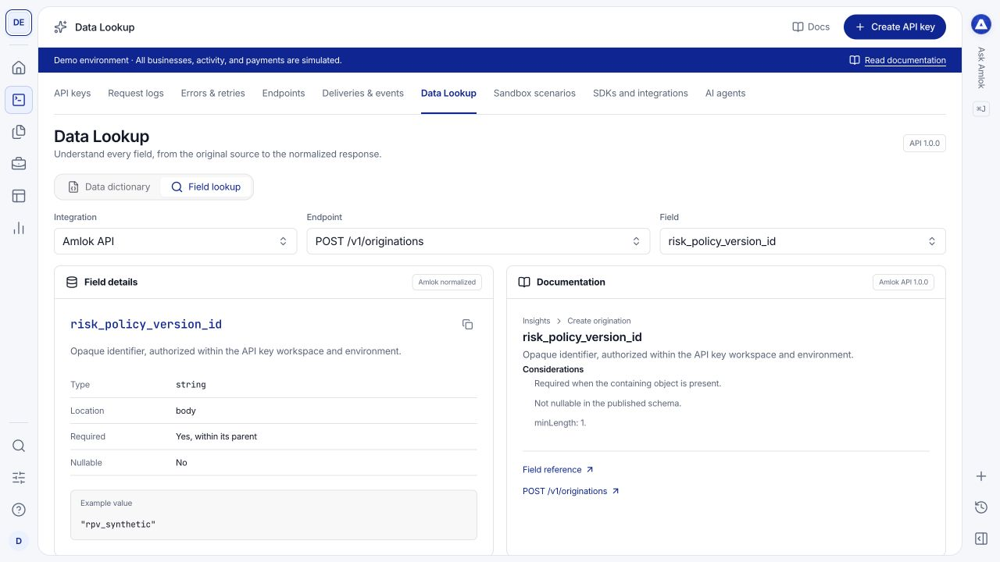

**Dev Tools > Data Lookup** helps you understand what an endpoint expects and what its response means. It is a reference tool: changing its selectors does not execute an API request or create a record.

## Explore the Data dictionary

<Steps>
  <Step title="Choose an endpoint">
    Open **Data dictionary** and select the method and endpoint you want to implement.
  </Step>
  <Step title="Compare request and response">
    Read the example request on the left and the example response on the right. Where response alternatives are offered, choose the status you need to understand.
  </Step>
  <Step title="Inspect individual fields">
    Expand nested structures and read the displayed field types. Use the field information controls for additional considerations. Follow a field into Field lookup for its fuller definition.
  </Step>
</Steps>

<Frame caption="The dictionary adds field information to example payloads instead of presenting an unexplained JSON block.">
  
</Frame>

An example is one valid case, not a promise that every optional field appears in every response. Read requiredness, nullability, units and enum values. For nested fields, requiredness applies within the parent structure when that structure is present.

## Use Field lookup

Select the three controls from left to right:

1. **Integration:** choose **Amlok API** for the normalized public contract, or an external integration for its source documentation.
2. **Endpoint:** choose the operation associated with the field.
3. **Field:** choose the exact field path, including its parent where relevant.

The left side explains the field and its available type, meaning and example information. The right side provides the associated endpoint or provider documentation. Changing the integration or endpoint changes which fields are relevant.

<Frame caption="Field lookup connects a selected field to its definition and supporting documentation.">
  
</Frame>

## Apply what you learn

Use the normalized AMLOK field when implementing the AMLOK API. A provider's source field can have different units, availability or meaning; it does not automatically become a top-level field in AMLOK's response. Check [data-model correspondence](/data-model/start-here) and [integration coverage](/integrations/status) when reconciling sources.

Then open [Sandbox scenarios](/console/sandbox) to execute a controlled case and [request logs](/console/request-logs) to inspect its actual response. The [API Reference](/api-reference/overview) remains the source for authentication, operation contracts, pagination and recovery behavior.
