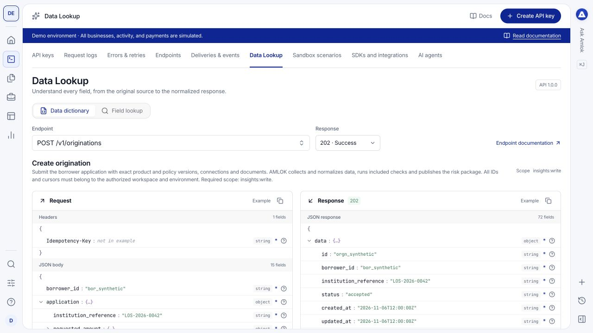

**Dev Tools > Data Lookup** helps you understand what an endpoint expects and what its response means. It is a reference tool: changing its selectors does not execute an API request or create a record.

## Watch a short walkthrough

This 56-second walkthrough covers the Data dictionary and Field lookup. It was recorded on [demo.amlok.io](https://demo.amlok.io) with fictional data. It uses on-screen instructions and has no audio. Use full screen to read the controls. The written steps below cover the same workflow.

<video controls playsInline preload="metadata" poster="/images/console/data-lookup.png" aria-label="The Data dictionary and Field lookup walkthrough recorded in the demo environment" width="100%">
  <source src="/videos/console/data-lookup.mp4" type="video/mp4" />
  Your browser does not support embedded video. <a href="/videos/console/data-lookup.mp4">Download the walkthrough</a>.
</video>

[Download the video](/videos/console/data-lookup.mp4) · [Download captions (WebVTT)](https://raw.githubusercontent.com/amloktech/docs/main/videos/console/data-lookup.vtt)

<Note>
  The video shows the isolated demo deployment's API URL. For your workspace on `console.amlok.io`, use `https://api.amlok.io` with an API key created in that workspace. Demo credentials do not grant access to your client workspace.
</Note>

## Explore the Data dictionary

<Steps>
  <Step title="Choose an endpoint">
    Open **Data dictionary** and select the method and endpoint you want to implement. Check the displayed API URL and required scopes. Sandbox and Live use the same API origin for that Console deployment; your key selects the workspace environment.
  </Step>
  <Step title="Compare request and response">
    Read the required request headers and example payload on the left, and the example response on the right. Authenticated endpoints require `Authorization: Bearer <API key>`; public health and service-status endpoints do not. Where response alternatives are offered, choose the status you need to understand.
  </Step>
  <Step title="Inspect individual fields">
    Expand nested structures and read the displayed field types. Use the field information controls for additional considerations. Follow a field into Field lookup for its fuller definition.
  </Step>
</Steps>

For `GET /v1/risk-packages/{id}`, use **Response view** to choose the complete package, summary, or a section. Both the request query and response example update together; **Copy request example** includes the matching `view` and, for a section, its `section` value. Section examples start on the first page without a cursor. When executing requests in your integration, use a returned cursor only for that same package and section; start without a cursor when switching sections. Full and summary requests omit section pagination. These selectors display examples and do not execute requests.

<Frame caption="The dictionary adds field information to example payloads instead of presenting an unexplained JSON block.">
  
</Frame>

An example is one valid case, not a promise that every optional field appears in every response. Read requiredness, nullability, units and enum values. For nested fields, requiredness applies within the parent structure when that structure is present.

## Use Field lookup

Select the three controls from left to right:

1. **Integration:** choose **Amlok API** for the normalized public contract, or an external integration for its source documentation.
2. **Endpoint:** choose the operation associated with the field.
3. **Field:** choose the exact field path, including its parent where relevant.

The left side explains the field and its available type, meaning and example information. The right side provides the associated endpoint or provider documentation. Changing the integration or endpoint changes which fields are relevant.

<Frame caption="Field lookup connects a selected field to its definition and supporting documentation.">
  
</Frame>

## Apply what you learn

Use the normalized AMLOK field when implementing the AMLOK API. A provider's source field can have different units, availability or meaning; it does not automatically become a top-level field in AMLOK's response. Check [data-model correspondence](/data-model/start-here) and [integration coverage](/integrations/status) when reconciling sources.

Then open [Sandbox scenarios](/console/sandbox) to execute a controlled case and [request logs](/console/request-logs) to inspect its actual response. The [API Reference](/api-reference/overview) remains the source for authentication, operation contracts, pagination and recovery behavior.

## Detailed financial intelligence

Use the [financial attribute library](/data-model/financial-attributes) for detailed calculated observations and [transaction categorization](/data-model/transaction-categorization) for versioned bank/card purpose classifications. The detailed collections extend the same risk package and its paged views; they do not replace the scalar policy metric catalog. In Console, open **Dev Tools → Data Lookup → Financial intelligence** to search the definitions, formulas and input requirements.
