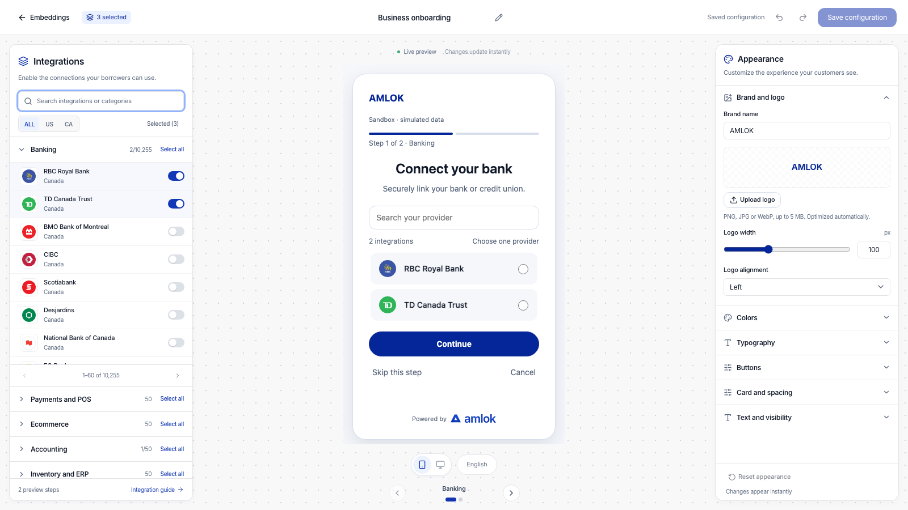

Use the Integrations Hub style designer to match the borrower experience to your brand. The **Appearance** panel controls the design, while the center preview shows your changes as you make them. You can try a design before saving it or using it in a borrower session.

An **Owner** or **Developer** can edit embeddings. First select the correct workspace and **Sandbox** or **Live** environment, then open **Embeddings**. Choose **Open builder** for an existing configuration, or [create an Integrations Hub](/console/embeddings#create-a-hub).

## See the designer

The integration catalog stays on the left, the borrower preview is in the center, and **Appearance** is on the right. On smaller screens, switch between the **Integrations**, **Preview** and **Appearance** tabs.

<Frame caption="Change the controls in Appearance and inspect the result in the borrower preview before saving.">
  
</Frame>

### Watch a short walkthrough

This 48-second walkthrough uses example data and on-screen instructions, with no audio. Use full screen to read individual controls. The written steps below cover the same workflow.

<video
  controls
  playsInline
  preload="metadata"
  poster="/images/console/embedding-style-designer.png"
  aria-label="Integrations Hub style designer walkthrough"
  width="100%"
>
  <source src="/videos/console/embedding-style-designer.mp4" type="video/mp4" />
  Your browser does not support embedded video. <a href="/videos/console/embedding-style-designer.mp4">Download the walkthrough</a>.
</video>

[Download the video](/videos/console/embedding-style-designer.mp4) · [Download the caption file](/videos/console/embedding-style-designer.vtt)

## Design your borrower experience

<Steps>
  <Step title="Start with your brand">
    Expand **Brand and logo**. Set **Brand name**, then optionally select **Upload logo**. Choose a PNG, JPG or WebP image up to 5 MB; transparent backgrounds are supported. The builder optimizes the image automatically.

    Adjust **Logo width** and **Logo alignment**. Use **Replace logo** for another image or **Remove logo** to show the brand name again. This logo belongs to the embedding and does not change the organization's profile logo. Wait for **Preparing…** to finish before saving.
  </Step>
  <Step title="Set colors and typography">
    Expand **Colors**. Use the color picker or enter a six-digit hex value, such as the default Amlok accent `#052698`. Check the **Readability** guidance after changing text or backgrounds.

    In **Typography**, choose a built-in font and adjust body size, heading size, heading weight and alignment. Review long headings and provider names in the preview as you change these settings.
  </Step>
  <Step title="Shape the buttons and layout">
    In **Buttons**, choose **Solid** or **Outline**, then set height, corner radius and shadow. **Solid button text** in Colors applies to solid buttons. Outline buttons use the brand accent for their text and border.

    Use **Card and spacing** to adjust the card and integration corners, border, shadow, inner padding and spacing between integrations. Keep enough room for a borrower to read and select each provider comfortably.
  </Step>
  <Step title="Write the category instructions">
    Expand **Text and visibility** and choose a **Category**. Edit its **Step heading** and **Step description**. Use **Reset category text** to restore that category's default wording.

    You can also change the **Continue**, **Connect** and **Back** labels and the provider-search placeholder. Use the switches to show or hide **Step progress** and **Amlok attribution**.

    Only categories with enabled integrations appear in the preview. Editing a category's text does not enable its integrations.
  </Step>
  <Step title="Check each step and save">
    Switch between **Mobile preview** and **Desktop preview**, then use the arrows or category dots to inspect each step. The borrower selects one provider at a time per category. Selecting another provider replaces the previous choice in that category; other categories keep their selections.

    Select **Save configuration**. Wait until the toolbar shows **Saved configuration** before leaving. The name, integrations and appearance are saved together.
  </Step>
</Steps>

## What each section controls

| Appearance section | Controls |
| --- | --- |
| **Brand and logo** | Brand name; logo upload, replacement and removal; logo width; left or center logo alignment. |
| **Colors** | Brand accent; solid button text; headings; body and supporting text; page and card backgrounds; borders; normal and selected integration backgrounds. |
| **Typography** | System sans, Arial, Georgia, Verdana, Trebuchet or Monospace; body and heading size; regular through bold heading weight; left or center text alignment. |
| **Buttons** | Solid or outline style; height; corner radius; none, soft, medium or strong shadow. |
| **Card and spacing** | Card and integration corners; border width; card shadow; card padding; integration padding and spacing. |
| **Text and visibility** | Category heading and description; navigation button labels; search placeholder; step progress; Amlok attribution. |

New embeddings start with Amlok colors. With **Amlok attribution** enabled, the footer shows **Powered by** followed by the full Amlok symbol and wordmark. Uploading your own header logo does not replace this footer branding. Existing custom colors are preserved when you reopen a saved embedding.

## Undo or restore the defaults

Use the toolbar's **Undo change** and **Redo change** buttons to move through edits made in the current editing session.

**Reset appearance** restores the default logo, colors, typography, layout and text after you confirm. It keeps the embedding name and enabled integrations. You can undo a reset before leaving the editor. Resetting also remains unsaved until you select **Save configuration**.

Leaving with unsaved changes prompts you to keep editing or discard them. Previewing a design does not connect a real provider account or update an existing borrower session.

## Use the saved design

Saving an edited configuration creates a new version. Open its record drawer to find the configuration version identifier. Your developer uses that version when creating new embedding sessions through the [Integrations Hub API workflow](/api-reference/integration-hub).

Existing sessions keep the design, text and integrations of their original version. To use the updated design, create new sessions with the new version identifier. There is no separate publish action in the style designer.

## Check before sharing

- Review all enabled category steps on both device previews, including long provider names and custom instructions.
- Use the **Readability** guidance in Colors. Aim for at least 4.5:1 for normal button, body and supporting text against their backgrounds.
- Keep required names and button labels filled in. Invalid colors or sizes leave the preview at the last valid value; correct the input before moving away from it.
- If a logo upload fails, try a supported image within the size limit. An upload error keeps your previous logo.
- If another editor has changed the record, reopen its current version before saving conflicting changes.

For provider selection, country filters and the full setup workflow, return to [Embeddings overview](/console/embeddings).
