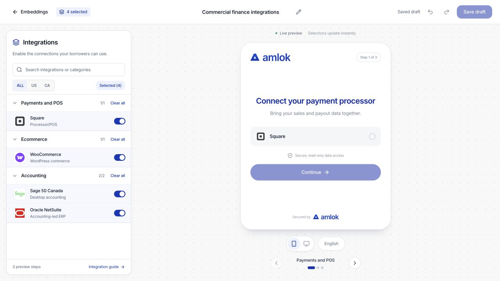

Use **Embeddings** to configure the integrations available in your borrower connection experience. An Owner or Developer chooses the providers; the borrower connects their own accounts through the embedded flow.

## Create a hub

1. Open **Embeddings** and select **Create embedding**.
2. Choose **Integrations Hub**. **Borrower Verification** is shown as unavailable.
3. Continue into the builder and give the configuration a recognizable name.

Existing embeddings appear in the table. Open a record to inspect it, or use **Open builder** to edit its configuration.

## Choose integrations

The left panel organizes integrations by category. New configurations start with integrations disabled.

- Use **ALL**, **US** or **CA** to filter the catalog by market. **ALL** is the default.
- Search for a provider or category, then expand the relevant category.
- Turn on each integration you want to offer.
- Use **Select all** to enable the integrations in the current filtered category. **Clear all** removes that selection.
- Use **Selected** to review what you have enabled.

Country and search filters change which entries you see; they do not themselves remove previously selected integrations. Review the selected list before saving. Catalog presence does not establish that a borrower has connected an account or that your organization has every required product entitlement.

<Frame caption="Select integrations on the left and inspect the borrower experience on the right. The preview contains only enabled choices.">
  
</Frame>

## Preview and save

The preview provides one step for each category with selected integrations. Use the step controls to move through the flow and the device controls to inspect phone and desktop layouts. Select a provider in the preview to understand the interaction; the preview does not connect a real account.

Use **Undo** and **Redo** while editing, then select **Save draft** to persist the configuration. If another editor has changed the same record, reload the current version before saving conflicting changes.

## Connect the hub to your application

Saving a draft configures the experience. Your developer uses the [Integrations Hub API workflow](/api-reference/integration-hub) to create the appropriate borrower session and embed it in your application. Keep workspace API credentials on your server.

The resulting connections and evidence belong to the relevant borrower and environment. Inspect them from the [origination evidence](/console/evidence) or [monitoring](/console/portfolio) views. Test with [Sandbox scenarios](/console/sandbox) before arranging Live activation.
