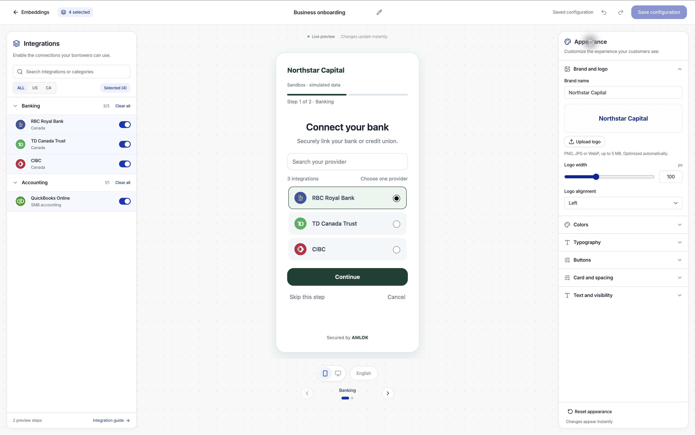

Use **Embeddings** to configure the integrations and appearance of your borrower connection experience. An Owner or Developer chooses the providers and design; the borrower connects their own accounts through the embedded flow.

## Create a hub

1. Open **Embeddings** and select **Create embedding**.
2. Choose **Integrations Hub**. **Borrower Verification** is shown as unavailable.
3. Continue into the builder and give the configuration a recognizable name.

Existing embeddings appear in the table. Open a record to inspect it, or use **Open builder** to edit its configuration.

## Find your way around the builder

The builder has three panels:

| Panel | What you do |
| --- | --- |
| **Integrations**, on the left | Search, filter and enable the providers you want to offer. |
| **Preview**, in the center | Inspect the customer-facing flow, category steps and phone or desktop layout. |
| **Appearance**, on the right | Set your brand, logo, colors, typography, buttons, spacing and text. |

On a smaller screen, use the **Integrations**, **Preview** and **Appearance** tabs to switch panels. Your edits stay in place while you move between them.

<Frame caption="Choose integrations on the left, inspect the borrower preview in the center and customize its appearance on the right.">
  
</Frame>

## Choose integrations

The left panel organizes integrations by category. New configurations start with integrations disabled.

- Use **ALL**, **US** or **CA** to filter the catalog by market. **ALL** is the default.
- Search for a provider or category, then expand the relevant category.
- Turn on each integration you want to offer.
- Use **Select all** to enable the integrations in the current filtered category. **Clear all** removes that selection.
- Use **Selected** to review what you have enabled.

Country and search filters change which entries you see; they do not themselves remove previously selected integrations. Review the selected list before saving. Catalog presence does not establish that a borrower has connected an account or that your organization has every required product entitlement.

## Customize the appearance

Expand a section in **Appearance** and change its controls. Valid changes appear immediately in the preview. They are saved only when you select **Save configuration**.

| Section | Available controls |
| --- | --- |
| **Brand and logo** | Brand name, logo upload or removal, logo width, and left or center alignment. |
| **Colors** | Brand accent, solid button text, headings, body and supporting text, page and card backgrounds, borders, and normal or selected integration backgrounds. Use the color picker or a six-digit hex value such as `#0c2ba8`. |
| **Typography** | Built-in font family, body and heading sizes, heading weight, and text alignment. |
| **Buttons** | Solid or outline style, height, corner radius and shadow. |
| **Card and spacing** | Card and integration corner radii, border width, card shadow, inner padding and spacing between integration choices. |
| **Text and visibility** | Each category's heading and description, Continue, Connect and Back labels, search placeholder, step progress and the Amlok attribution footer. |

**Solid button text** applies when **Button style** is **Solid**. Outline buttons use **Brand / accent** for their text and border against the card background.

Under **Text and visibility**, choose the category before editing its heading or description. Editing category text does not enable its integrations. Only categories with selected integrations appear as preview steps. **Reset category text** restores that category's default heading and description.

Required names and button labels cannot be empty. If you temporarily clear a required value or enter an invalid color or size, the preview keeps the last valid value. Correct the field before leaving it; otherwise it returns to that value.

### Add your logo

Select **Upload logo**, then choose a PNG, JPG or WebP image up to 5 MB. The builder converts it to an optimized PNG, at most 200 KB and 1200 by 1200 pixels. Transparent backgrounds are supported. Unsupported or unreadable images show an error without replacing your existing logo.

Use **Replace logo** to choose a different image, or **Remove logo** to return to the brand name. Adjust **Logo width** and **Logo alignment** in the preview. Wait for image preparation to finish before saving. The logo is saved with this embedding; it does not change your organization's profile logo.

### Keep the flow readable

The **Colors** section provides contrast guidance for button, body and supporting text against their backgrounds. Aim for at least 4.5:1 for normal text. Check every category in both device previews, especially with long provider names or a custom heading. The available fonts are built in; you do not need to host a font file.

## Preview and save

The preview provides one step for each category with selected integrations. Use the step controls to move through the flow and the device controls to inspect phone and desktop layouts. The borrower chooses one provider per category step using radio buttons. Choosing another provider replaces the previous choice for that step; choices in other categories remain selected. The preview follows the same behavior without connecting a real account.

- Use **Undo** and **Redo** to move through integration and appearance edits in the current editing session.
- Select **Reset appearance** and confirm to restore the default branding, styling and text. Your embedding name and selected integrations stay the same. You can undo a reset before leaving the editor.
- Select **Save configuration** to persist the name, integrations and appearance together. Saving an edited configuration creates a new version.
- If you leave with unsaved changes, choose whether to keep editing or discard them. An unsaved preview does not change the customer experience.

If another editor has changed the same record, reopen the current version before saving conflicting changes.

## Connect the hub to your application

Saving creates a versioned configuration for the selected workspace and environment. The record drawer shows its configuration version identifier. Read `embedding_versions` from `GET /v1/configuration` and use that identifier when creating an embedding session. To use a saved design update, create new sessions with the new version identifier.

Existing sessions keep the integrations, appearance and text from the version with which they were created. Saving a new version does not change a borrower flow already in progress. Your developer uses the [Integrations Hub API workflow](/api-reference/integration-hub) to create the appropriate borrower session and embed it in your application. Keep workspace API credentials on your server.

The resulting connections and evidence belong to the relevant borrower and environment. Inspect them from the [origination evidence](/console/evidence) or [monitoring](/console/portfolio) views. Test with [Sandbox scenarios](/console/sandbox) before arranging Live activation.
