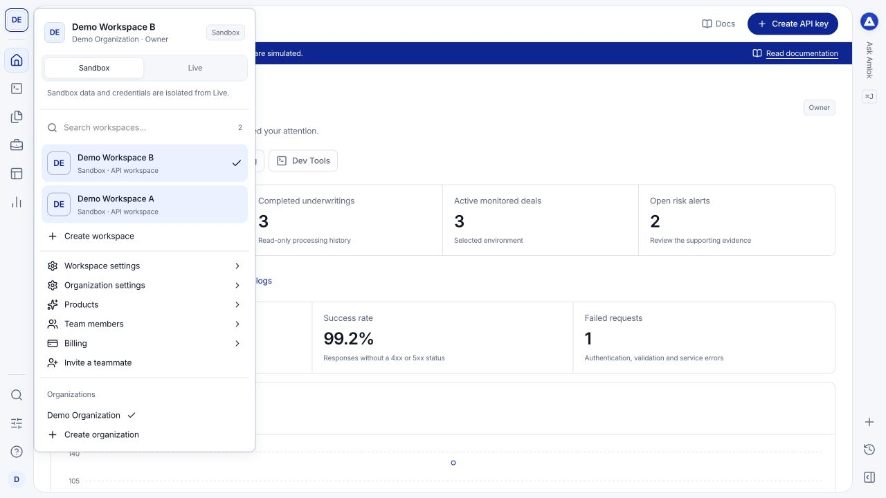
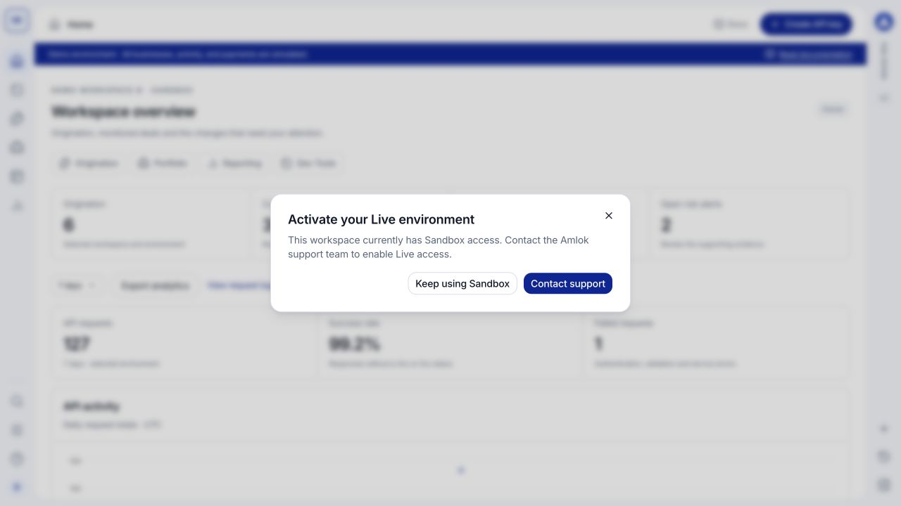

Every console view belongs to a selected workspace and environment. Check that context before inspecting an empty table, creating an API key, configuring an integration or reviewing a balance.

## Four concepts to keep separate

| Concept | What it means |
| --- | --- |
| **Account** | Your personal sign-in and security settings. |
| **Organization** | Your institution's identity, organization-level access and billing profile. |
| **Workspace** | A separate working area for integrations, product activity and authorized teammates. |
| **Sandbox or Live** | Separate data and credentials within a workspace. Sandbox is for testing; Live is for activated operations. |

## Switch workspaces or environments

<Steps>
  <Step title="Open the workspace profile">
    Select the avatar or initials at the top of the left navigation. The menu shows your workspace, organization, role and selected environment.
  </Step>
  <Step title="Choose the workspace">
    Search the workspace list when necessary and select the workspace you need. If it belongs to another organization, switch organizations first.
  </Step>
  <Step title="Choose Sandbox or Live">
    Select the environment switch and check the banner after the view updates. Your API keys, records and financial activity must match the environment you intend to use.
  </Step>
</Steps>

<Frame caption="The workspace menu keeps workspace selection, environment and settings together.">
  
</Frame>

## Console and API addresses

Use [console.amlok.io](https://console.amlok.io) for your customer workspace. Both Sandbox and Live API keys call `https://api.amlok.io`; the key selects the environment. Switching this menu does not change credentials already used by your backend. Amlok staging and demo deployments are separate from your workspace Sandbox. See [URLs and environments](/api-reference/environments).

## Activate Live

New workspaces start with Sandbox access. Selecting **Live** before activation opens **Activate your Live environment**. Choose **Contact support**, or **Keep using Sandbox** to continue testing. Ask your Owner to coordinate activation with AMLOK.

<Frame caption="Live access is activated separately. Selecting the switch does not promote Sandbox data.">
  
</Frame>

Loading sample businesses does not create Live borrowers. Switching to Live does not copy test keys, consent, integrations, documents, records or credits. Configure and verify the Live integration separately after activation.

## Sandbox compared with Live

Sandbox supports executable scenarios, fictional integration data and simulated financial records. It does not bill you. Live processes authorized borrower activity and financial records under your agreement. See the [full comparison](/sandbox/overview).

The demonstration console used in screenshots has a **Demo environment** banner. It is a separately hosted example with synthetic data, not a third switch inside your workspace. You can learn and test in Sandbox on the regular customer console.

If a record appears to be missing, clear table filters and confirm workspace and environment before assuming it was deleted. A record link identifies a record; it does not grant access to another workspace.
