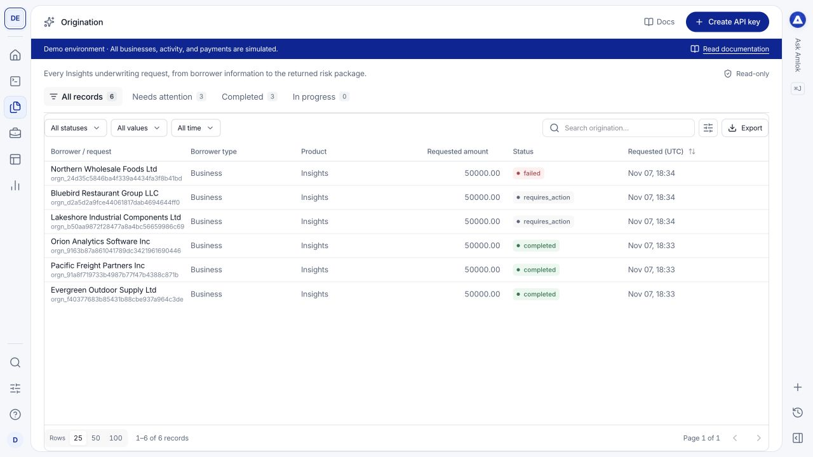

The console uses the same compact table and right-side drawer pattern across borrower activity, developer tools and settings. Learn these controls once and use them throughout the workspace.

## Narrow a table

| Control | What to do |
| --- | --- |
| Views such as **All records**, **Needs attention** or **Completed** | Choose the subset relevant to your task. Available views depend on the screen. |
| Status, type and date filters | Combine filters to narrow the records. Labels vary with the collection. |
| Search | Enter a borrower name, record identifier or other identifying text. |
| Column heading | Click to sort; click again to change direction. |
| **Choose columns** | Show the fields useful for your current review. |
| Rows **25**, **50**, **100** | Change the number displayed per page, then use the page arrows. |
| **Clear filters** | Remove active filters when the expected record is hidden. |

<Frame caption="Origination uses the shared compact table: views above, filters and search beside the table, and pagination below.">
  
</Frame>

For product records and audit events, **Export** prepares every record matching your filters, including records beyond the visible page. Wait for **Download CSV** before downloading. You can continue browsing while preparation runs. The export contains table summaries; use a record drawer or [API exports](/api-reference/large-results) for complete business payloads and evidence.

Exports expire after one hour. If your permissions, enabled products or source consent change, create a new export. Each user can have two exports preparing at a time and start ten per hour. Each CSV is limited to 256 MiB. If an export exceeds that limit, narrow your filters and create smaller exports.

## Open and navigate a record

Select the record name or its row to open a drawer from the right. The table stays behind it, so you can keep your review context. The drawer uses up to 60% of a wide viewport and adapts to smaller screens.

- Use **Previous record** and **Next record** to move through the current results.
- Use the drawer tabs for the overview, payloads and related evidence available for that record type.
- Expand an accordion to inspect an object, log or additional details.
- Use **Copy record ID** for investigation and **Copy record link** to share with an authorized teammate.
- Close with **Close details**, the close icon or Escape to return to the table.

Copied record links include the organization, workspace and Sandbox or Live environment. The recipient still needs access to that workspace. A Live link cannot activate Live access for a Sandbox-only workspace.

An **Actions** menu contains the operations permitted for that collection and your role. Opening details is read-only. Editing configuration requires its own action and may ask you to confirm your identity.

## Read values carefully

A dash or an absent field means that the view has no value to show; it is not proof of zero, no risk or a successful verification. Review the payload, coverage and source evidence before drawing a conclusion. Timestamps labeled **UTC** use UTC, even if your computer uses a different timezone.

If a copied link does not open, check [workspace access and environment](/console/environments) before asking the sender to create another record.

## See new API activity

Record lists refresh when you return to the Console window or select **Refresh**. Search, filters, sort order and displayed counts apply to all matching product records in the selected workspace and environment. The table loads only the current page; a drawer retrieves its record when you open it.

New records do not enter an existing page traversal until you refresh. Updates to existing records remain visible, so a change to a sort or filter value can move a record while you browse. Refresh to reconcile a changing list. Use a completed CSV export when you need a consistent set of matching rows.

A page cursor expires after 15 minutes. If you see a page-expired message, refresh the table. Changing filters, workspace or environment starts a fresh traversal. If a query is busy or takes too long, narrow the date range or search and retry.

Large nested objects open only when expanded. Arrays show a bounded group of items with their own page controls. JSON panels may show a shortened preview; use the explicit full-data copy action or API response when you need the complete payload.
