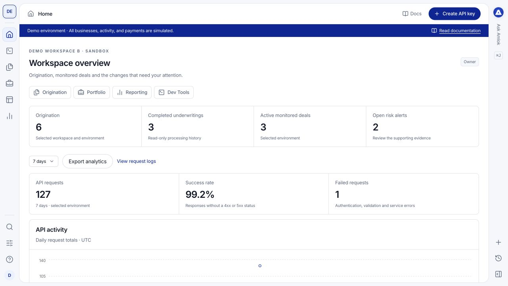

The AMLOK Console is your workspace for inspecting Insights underwriting, following Signal monitoring, configuring borrower integrations and understanding API activity. These guides show the steps you take in the interface and where to find the records behind each result.

<Columns cols={2}>
  <Card title="Start your first session" icon="rocket" href="/console/quickstart">Join your workspace, choose Sandbox starting data and open your first underwriting result.</Card>
  <Card title="Review underwriting" icon="files" href="/console/origination">Follow an origination from the submitted application to its risk package and evidence.</Card>
  <Card title="Build your integration" icon="square-terminal" href="/console/api-keys">Create a scoped key, understand fields and trace requests and webhook events.</Card>
  <Card title="Manage your workspace" icon="settings" href="/console/workspaces">Manage organizations, workspace access, products and your team's configuration.</Card>
</Columns>

## Find the right area

| Area | Use it to |
| --- | --- |
| **Home** | See activity totals, completed underwritings, monitored deals and records needing attention. |
| **[Borrowers](/console/borrowers)** | Find registered businesses and people, including borrowers without underwriting or monitoring records. |
| **Origination** | Review Insights requests, underwriting outcomes, application inputs and supporting evidence. |
| **Portfolio** | Review monitored deals, integration activity, baselines and notifications or flags. |
| **Embeddings** | Configure the integrations borrowers can choose in an Integrations Hub. |
| **Dev Tools** | Manage keys and endpoints, inspect requests and deliveries, look up fields and run Sandbox scenarios. |
| **Reporting** | Explore API performance, product consumption, processing workload and exports. |
| **Workspace profile and settings** | Switch workspaces or environments and manage settings, team access and billing. |

Your role determines which areas appear. See [roles and workspace access](/console/team).

<Frame caption="Home in the demonstration workspace. Counts, businesses and payments in these screenshots are synthetic.">
  
</Frame>

## Understand what the console controls

The console provides configuration and record review. Your integration submits borrower applications and documents, starts underwriting and supplies monitoring inputs through the API. Viewing a record, filtering a table or opening its drawer does not rerun processing or change a lending decision.

**Insights** produces an underwriting risk package. **Signal** monitors change after funding. Your institution makes lending and intervention decisions in its own systems.

## Choose a learning path

- **Workspace administrators:** [Workspace setup](/console/workspaces), [team invitations](/console/team), [security](/console/security) and [billing](/console/billing).
- **Risk and operations teams:** [Origination](/console/origination), [evidence](/console/evidence), [Portfolio](/console/portfolio) and [reporting](/console/reporting).
- **Developers:** [API keys](/console/api-keys), [Data Lookup](/console/data-lookup), [Sandbox scenarios](/console/sandbox) and [webhooks](/console/webhooks).

[Open your console](https://console.amlok.io/) to follow along. Screenshots use a separate demo deployment; your names, permissions, record counts and enabled integrations will differ. You do not need access to the demo to follow the guides in your own Sandbox.

