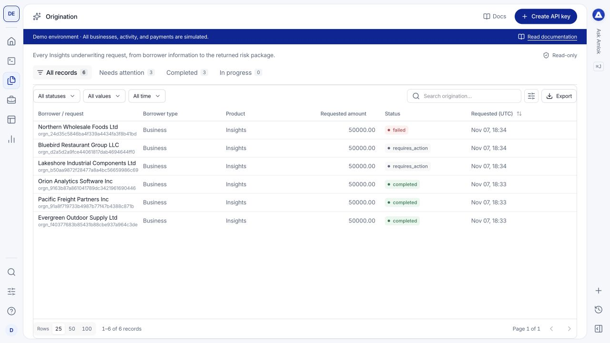
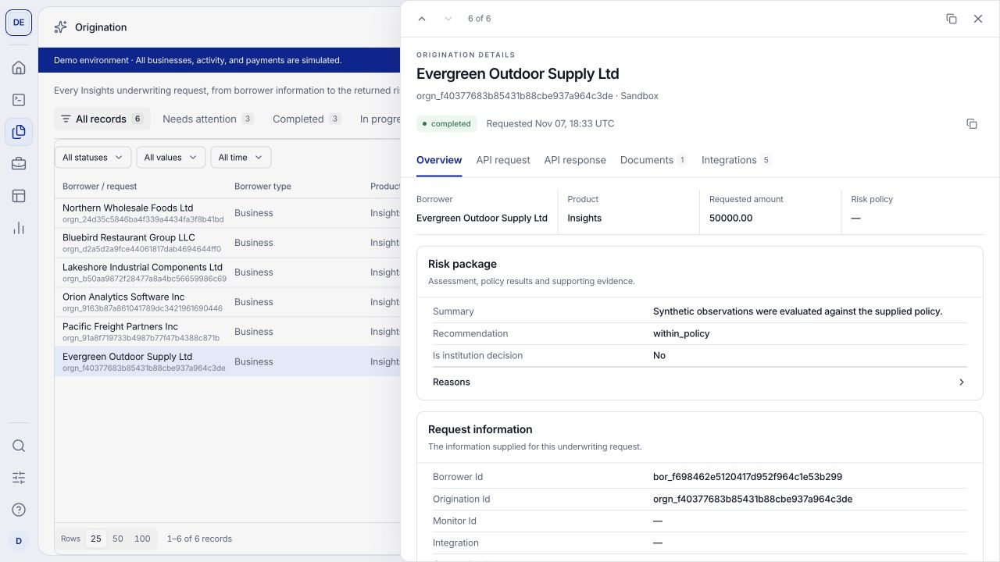
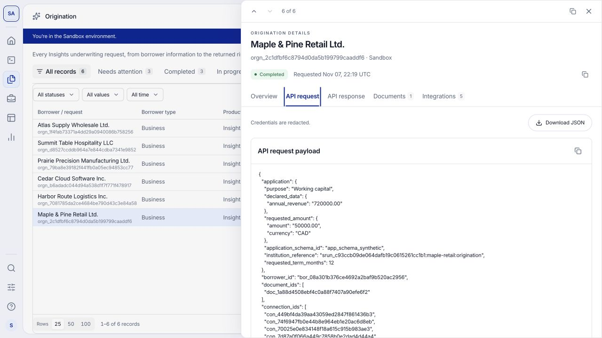
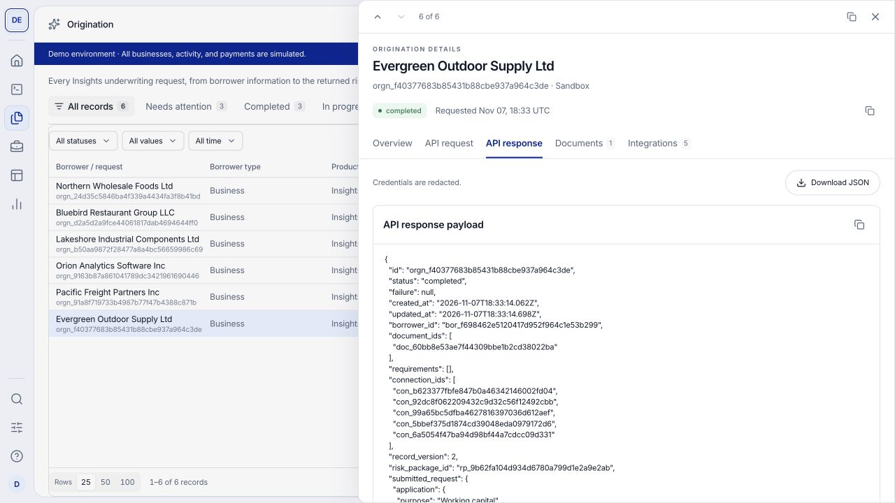
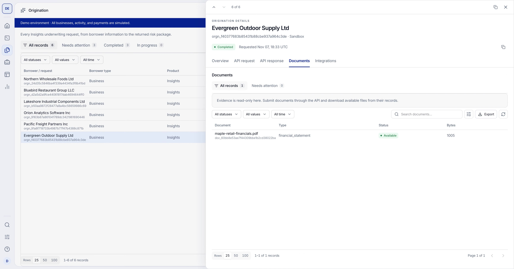
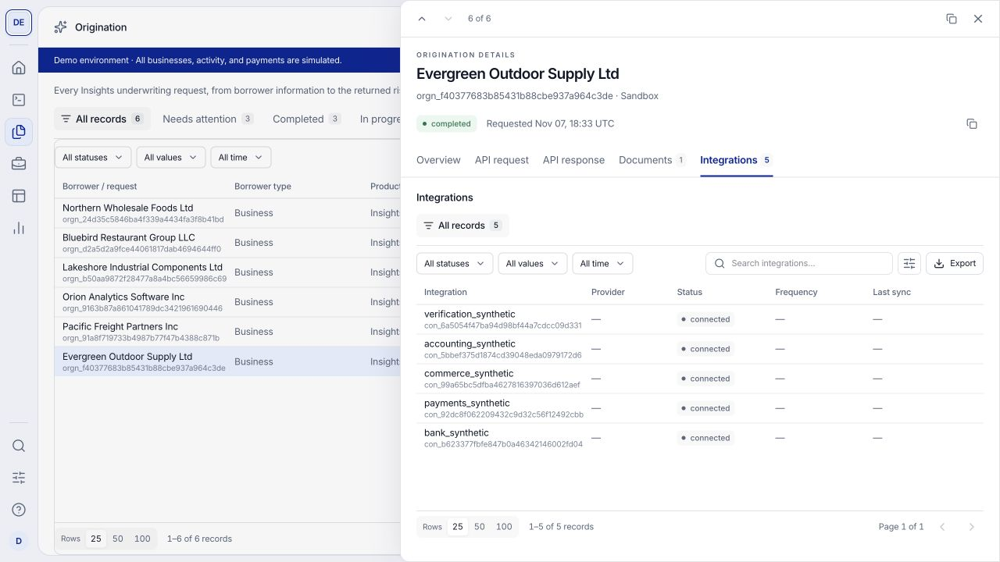

Use **Origination** to review the underwriting your integration submits to Insights. Each record brings together the application inputs, processing state, risk package, documents and connected sources.

## Watch a short walkthrough

This 48-second walkthrough covers the five origination drawer tabs. It was recorded on [demo.amlok.io](https://demo.amlok.io) with fictional data. It uses on-screen instructions and has no audio. Use full screen to read the controls. The written steps below cover the same workflow.

<video controls playsInline preload="metadata" poster="/images/console/origination-review.png" aria-label="The five origination drawer tabs walkthrough recorded in the demo environment" width="100%">
  <source src="/videos/console/origination-review.mp4" type="video/mp4" />
  Your browser does not support embedded video. <a href="/videos/console/origination-review.mp4">Download the walkthrough</a>.
</video>

[Download the video](/videos/console/origination-review.mp4) · [Download captions (WebVTT)](https://raw.githubusercontent.com/amloktech/docs/main/videos/console/origination-review.vtt)

<Note>
  Creating a borrower does not submit an underwriting request. Open [Borrowers](/console/borrowers) to find a business or person registered through `POST /v1/borrowers`. It appears in Origination after you submit an origination for it.
</Note>

## Find and open an origination

Open **Origination** in the left navigation. Use the status views, filters and search to locate the borrower or request. Check the selected workspace and environment before searching for an identifier from your application.

<Frame caption="The origination table combines completed results with cases that need attention. These businesses are fictional.">
  
</Frame>

Select a row to open its drawer. Confirm the borrower, origination identifier and environment in the header. The arrows move between records in the list; closing the drawer returns you to the table. **Copy record ID** helps you correlate the case with your own system or a support request.

| Tab | The question it answers |
| --- | --- |
| [Overview](#overview) | What did underwriting find, and what information supports it? |
| [API request](#api-request) | What inputs and references were captured for this run? |
| [API response](#api-response) | What does the returned origination record contain? |
| [Documents](#documents) | Which files are associated with this origination? |
| [Integrations](#integrations) | Which borrower connections are associated with this origination? |

<Info>
  **API request** and **API response** are visible to Owners and Developers. Analysts use Overview, Documents and Integrations. Record counts describe associated records, not completed checks or a guarantee of complete evidence.
</Info>

## Overview

Start here for a readable review of the result. The summary identifies the borrower, product, requested amount and risk policy when supplied. Scroll through the drawer to inspect:

- **Risk package:** the available underwriting result and its supporting dimensions. Expand nested sections to read their values, coverage and qualifications.
- **Request information** and **Underwriting inputs:** the application facts used for this run, such as requested financing and declared business information.
- **Borrower information:** the subject of the assessment and its recorded attributes.
- **Published evidence** and **Activity:** associated published records and recorded activity when available. Open an evidence row for further detail.

<Frame caption="Overview brings the readable risk package and its inputs together. Scroll within the drawer for evidence and additional sections.">
  
</Frame>

For example, review Evergreen Outdoor Supply's requested amount alongside its policy result, then compare the declared application information with the evidence used. A missing risk package means there is no published result to review here; it is not a decline. An absent metric is not zero.

## API request

Use this tab when investigating unexpected results or checking what your integration submitted. Inspect the captured payload for the borrower, application facts, document and connection identifiers, and lending-product and risk-policy version references.

<Frame caption="The captured request view supports technical inspection and JSON download. Check the submitted inputs within the payload.">
  
</Frame>

This tab shows the submitted request fields, including `application`, `borrower_id`, document and connection references, and the policy/product versions. The returned resource and its `submitted_request` copy appear separately in **API response**. Use [Data Lookup](/console/data-lookup) to check the endpoint's request fields and required structure before submitting another request.

Use the copy control or **Download JSON** to inspect the payload locally. **Related API requests** lists linked request logs when available. If that list is empty, search [Request logs](/console/request-logs) using the identifiers you have; an empty relationship list does not prove that no request was sent. Opening or downloading the captured request does not submit it again.

## API response

Use this tab to understand the returned origination record and compare it with your application's handling of the result.

<Frame caption="The response identifies the origination's state and associated result. A risk package reference can point to a separately retrieved package.">
  
</Frame>

Check the resource identifier, processing `status`, timestamps and `record_version`. Inspect `failure` or `requirements` when present, and follow the `risk_package_id` to the published result. The response can contain a reference to the risk package rather than the full package inline. Use **Overview** for the readable result and the [risk package contract](/api-reference/risk-package) for programmatic retrieval.

Copy or download the JSON to compare the fields with [Data Lookup](/console/data-lookup). For the original HTTP status and timing, open the corresponding request log. An accepted asynchronous request is not yet a completed assessment; a completed assessment is not necessarily a within-policy recommendation.

## Documents

Use this tab to distinguish the assessment's file associations from other files uploaded for the primary borrower. Each table has its own search, filters and pages, with **Document**, **Type**, **Status** and **Bytes** columns. Select a row to inspect its metadata.

| Section | What it contains |
| --- | --- |
| **Associated documents** | Primary-borrower and participant files referenced by this origination, plus uploads explicitly targeted at its document requirements. Processing and rejected uploads can appear here; their presence does not mean they were used in the result. |
| **Other borrower documents** | Files for the primary borrower that are not associated with this origination, including later borrower-only uploads. These do not change the assessment or its evidence. |

To inspect another participant's additional files, open that participant's profile in [Borrowers](/console/borrowers). Files from different people or businesses retain their own borrower association.

<Frame caption="Documents lists the supporting file records for this origination. Open a row to inspect its metadata and download availability.">
  
</Frame>

Check the file's identity and status before relying on it. A dash means metadata is not supplied in that view. A file being listed does not mean every verification check passed or every required document is present.

**Download** is available for an authorized, available file. Processing, rejected or restricted files cannot be downloaded. Metadata exports contain record information, not the file bytes.

An upload response of `202` means the file was accepted for processing. Wait until its status is **Available** before including it in a new underwriting request. A borrower-only upload made after this assessment appears in **Other borrower documents**; refreshing does not make it part of the completed result.

To use that file in underwriting, submit a new assessment through your integration with the available file ID and the documented reassessment references. For a still-open document requirement, upload against that specific requirement instead. This drawer is read-only and does not attach files or rerun underwriting. See the [document workflow](/api-reference/documents) for both paths.

## Integrations

Use this tab to identify the borrower connections associated with the origination, such as banking, payments, commerce or accounting sources. These are case-linked connections, not the catalog of providers enabled in your Integrations Hub.

<Frame caption="The Integrations tab shows the connections linked to the underwriting run. Demo sources are synthetic.">
  
</Frame>

The table shows **Integration**, **Data availability**, **Status**, **Source as of (UTC)** and **Last sync (UTC)**, where recorded. Select a row for its readable details and available source information. Owners and Developers can also inspect captured technical payloads when present.

Check connection status and the available sync timestamps when a result has incomplete or stale evidence. A **Connected** status describes the connection; it does not guarantee that all expected data was retrieved. Missing source or sync information is not proof of a failed or successful refresh. Compare the connection with the risk package's coverage and [supporting evidence](/console/evidence).

## Interpret processing and recommendation separately

| What you see | What it tells you |
| --- | --- |
| **Completed** | Processing produced a result. It does not mean your institution approved the borrower. |
| **Requires action** | Processing needs attention or additional input. Inspect the specific reason and missing evidence. |
| **Failed** | Processing could not complete. Inspect its error and related request records before retrying. |
| **Within policy** | The assessed inputs meet the evaluated policy conditions, subject to the package's coverage and limitations. |
| **Outside policy** | The package identifies policy conditions the assessed inputs do not meet. |
| **Review required** | A person should review the evidence or unresolved conditions. |

The risk package is decision support. Your institution owns the final lending decision. To investigate a case, compare Overview with the captured inputs, then check its documents, connections and request logs. Opening the drawer does not edit the application or rerun underwriting; submit corrections through the documented API workflow.

Continue with [underwriting dimensions](/api-reference/underwriting-dimensions) or follow an enrolled deal in [Portfolio](/console/portfolio).

{/* BEGIN BORROWER LIFECYCLE */}
## Open the shared identity profile

Select **View shared borrower profiles** to open [Borrowers](/console/borrowers) for the same workspace and environment. Registered profiles appear there before an application or monitored facility exists. The profile drawer separates current identity and lifecycle from underwriting requests and monitored deals. Owners and Developers can correct, archive or restore the profile without changing historical results.
{/* END BORROWER LIFECYCLE */}

## Distinguish progress, recommendations and identity

**Needs attention** includes completed assessments whose recommendation is **Review required**, as well as workflows with actionable processing states. **Within policy**, **Outside policy** and **Review required** describe the package's actual recommendation; they do not replace your institution's lending decision.

A processing, failed or cancelled origination without a published result shows **No risk package available** and its workflow status. Submitted input and the API's origination response are not presented as an assessment result.

**Current borrower profile** shows the latest identity. **Identity at assessment** shows the profile and revision accepted for the immutable result. Compare these if a business name, registration or person profile was corrected after the assessment. A correction does not rewrite the earlier package.
