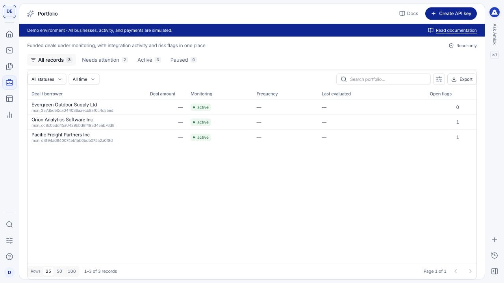
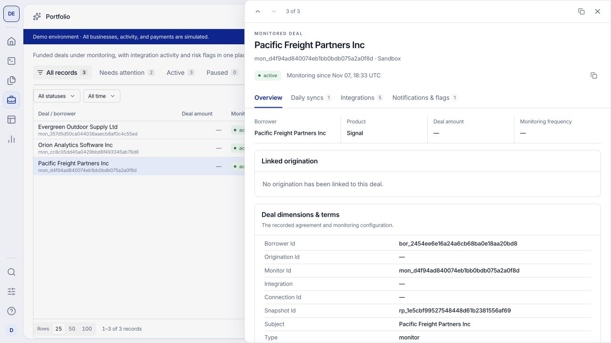
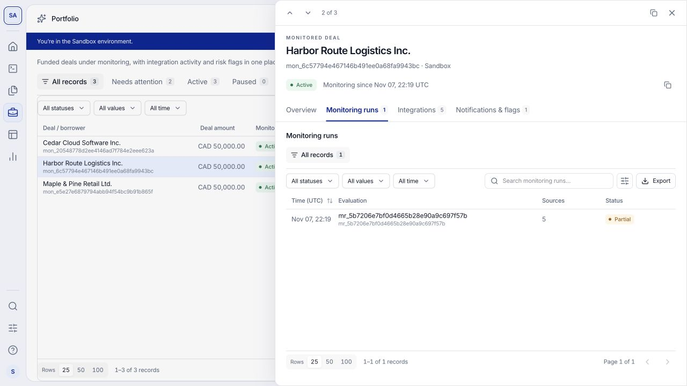
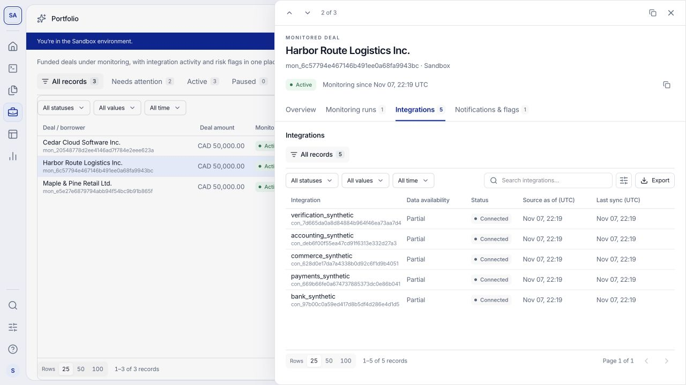
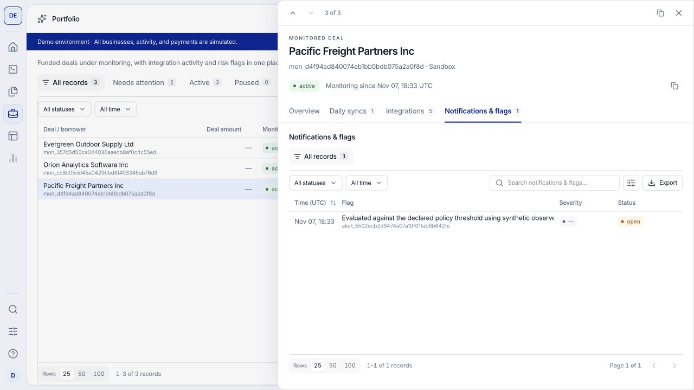

Use **Portfolio** to follow deals enrolled in Signal. A monitored deal connects the borrower, the monitoring baseline and the changes detected from available evidence.

## Watch a short walkthrough

This 62-second walkthrough covers a monitored deal, its flags and the associated event. It was recorded on [demo.amlok.io](https://demo.amlok.io) with fictional data. It uses on-screen instructions and has no audio. Use full screen to read the controls. The written steps below cover the same workflow.

<video controls playsInline preload="metadata" poster="/images/console/portfolio-review.png" aria-label="A monitored deal, its flags and the associated event walkthrough recorded in the demo environment" width="100%">
  <source src="/videos/console/portfolio-review.mp4" type="video/mp4" />
  Your browser does not support embedded video. <a href="/videos/console/portfolio-review.mp4">Download the walkthrough</a>.
</video>

[Download the video](/videos/console/portfolio-review.mp4) · [Download captions (WebVTT)](https://raw.githubusercontent.com/amloktech/docs/main/videos/console/portfolio-review.vtt)

## Find and open a monitored deal

Open **Portfolio**, filter the table and select a deal. Check the borrower, monitoring status and available deal terms. Use the record identifier when matching a console record to your servicing system.

<Frame caption="The portfolio table gives you a starting point for reviewing active monitoring records. These businesses are fictional.">
  
</Frame>

Selecting a row opens a drawer over the table. Its header identifies the deal, environment, status and monitoring start time. Use the arrows to move between records or close the drawer to return to your list.

| Tab | The question it answers |
| --- | --- |
| [Overview](#overview) | What is being monitored, and what is the current context? |
| [Monitoring runs](#monitoring-runs) | What evaluations ran, which sources were included, and what was the result? |
| [Documents](#documents) | Which files are associated with this monitored deal, and which belong only to the borrower? |
| [Integrations](#integrations) | Which connections support this monitoring record? |
| [Notifications & flags](#notifications-and-flags) | What changes need attention, and were their notifications delivered? |

The count on a tab represents associated records. It is not a coverage score. Missing values or an empty list should not be interpreted as a healthy result.

## Overview

Start here to establish the context before investigating a change. The summary shows the borrower, Signal product, deal amount and monitoring cadence when available. Scroll through the drawer for:

- **Linked origination:** the original underwriting record, when linked. Follow it to compare with the original risk package and application evidence. No linked origination means the relationship is absent, not that underwriting failed.
- **Deal dimensions & terms:** recorded financing details and terms. Expand nested values such as funded or outstanding amounts when provided.
- **Current borrower profile:** the latest identity. **Identity at assessment** preserves the profile and revision accepted for the latest published result.
- **Latest risk package:** the current published assessment, policy outcome and evidence. A monitor without a published result shows its status and an explicit empty result.
- **Monitoring overview:** the last evaluation, integration count, recorded syncs and open flags. **Last evaluated** is the latest recorded monitoring run's `completed_at`, not the time someone changed the monitor configuration. A dash means no completed timestamp is available.
- **Monitoring baselines:** associated baseline records. Open a row to inspect the available baseline information. **Activity** appears when activity is recorded.

<Frame caption="Overview establishes the deal and borrower context before you investigate a sync or flag. Scroll down to review monitoring and baseline information.">
  
</Frame>

Use the baseline and evidence dates to understand a reported change. A deal's active monitoring status does not establish that every connected source is current. A dash means the value is not supplied in that view.

## Monitoring runs

Use **Monitoring runs** to inspect evaluations associated with this monitored deal. The table shows **Record**, **Status** and **Created (UTC)**. Filter or search the records, then select a row for its details, available summary and outcome.

<Frame caption="Monitoring runs shows recorded evaluations and their outcomes. These fictional partial results deserve further inspection.">
  
</Frame>

When a value appears stale, check the most recent relevant sync, its source association and its status. The readable run details include source coverage, limitations and available failure explanations for Analysts as well as Owners and Developers. Missing data remains distinct from a zero value. Owners and Developers can inspect captured request or response payloads and download JSON where provided.

**Monitoring runs** lists scheduled or change-driven evaluations, which can combine several sources. Inspect a run for its available source details. A successful evaluation describes that recorded activity; it does not establish the freshness of every source. An empty tab means no related evaluation is shown. Opening a row does not trigger a refresh or retry.

## Documents

Open **Documents** to inspect files associated with the monitored deal, its baseline and latest risk package. **Associated documents** includes those explicit links; it does not claim every file was used in every monitoring run. Inspect the individual published package's evidence references for that result.

**Other borrower documents** lists additional files for the primary borrower, excluding the associated set. Each section has separate search, filters and pagination. Select a file for metadata and use **Download** when it is available and authorized. Processing, rejected and restricted files retain their status and cannot be downloaded.

Uploading another borrower file does not change earlier monitoring results. Follow the [monitoring workflow](/api-reference/monitoring-design) for accepted inputs and use the result's own evidence references when reconciling a historical run. Additional files for a participant are available through that identity's [borrower profile](/console/borrowers).

## Integrations

Use this tab to review the borrower connections linked to the monitored deal. The table shows **Integration**, **Data availability**, **Status**, **Source as of (UTC)** and **Last sync (UTC)**, where recorded. Select a row to inspect its details and available source information.

<Frame caption="These five synthetic connections belong to the selected monitored deal. Source status and data freshness answer different questions.">
  
</Frame>

Check this tab when a flag concerns missing data or a disconnected source. Compare the connection's status with **Monitoring runs** and the evidence timestamps. A connected source can still have incomplete or stale observations, and missing sync metadata does not prove that a refresh succeeded.

This list is different from the [Integrations Hub](/console/embeddings): the Hub controls which integrations borrowers can select; this tab shows connections associated with the selected deal. Inspecting a connection does not reconnect it or change the Hub configuration. Owners and Developers can inspect additional captured technical payloads when available.

## Notifications and flags

Open **Notifications & flags** to review detected changes associated with the monitored deal. The table shows **Notification**, **Severity**, **Status** and **Created (UTC)**. Start with the event's reason and current state, then examine the supporting context.

<Frame caption="Notifications and flags stay attached to the monitored deal they describe. Open a flag to inspect its explanation and associated deliveries.">
  
</Frame>

<Steps>
  <Step title="Read the flag">
    Select its row. Review the readable fields and summary, including available measurements and evidence references. Compare **Previous value**, **Current value**, **Threshold**, unit, policy rule and linked packages where supplied. These readable measurements do not require access to raw technical JSON. Severity indicates the reported importance; status describes the flag's current state.
  </Step>
  <Step title="Inspect the event payload when needed">
    Owners and Developers can open **Raw data** to inspect the alert payload, including its metric, threshold, policy rule and evidence references when supplied. Use the alert and monitor identifiers to correlate it with your own system.
  </Step>
  <Step title="Check the delivery history">
    Open **Related records**, then select the associated event, such as `alert.created`. Its **Overview** identifies a **Recorded event** and links its **Webhook delivery attempts**. Open an attempt for its recorded result and available response details. A generated flag does not prove your endpoint received it. Multiple attempts can belong to one event; they are not necessarily separate risk changes.
  </Step>
</Steps>

If no delivery is shown, use [Dev Tools > Deliveries & events](/console/webhooks) to investigate the destination and related event identifier. If the event concerns stale or missing evidence, check **Integrations** and **Monitoring runs** before interpreting it as a change in the business itself.

## Decide what happens next

A monitoring event reports a change or condition; it does not itself change a credit limit, collect a payment or contact the borrower. Your institution decides the appropriate action. Viewing an alert does not acknowledge it in your servicing system, resolve it or replay a webhook.

For a practical exercise, open Pacific Freight Partners in the demo dataset, inspect its partial monitoring run and open flag, then trace the associated event. The walkthrough shows an event with no delivery attempts, illustrating why event creation and successful delivery are separate checks. Use [Sandbox scenarios](/console/sandbox) to test a changing-risk case and a source-disconnection case. See [monitoring design](/api-reference/monitoring-design) for enrollment, baseline and event contracts.

{/* BEGIN BORROWER LIFECYCLE */}
## Open the shared identity profile

Select **View shared borrower profiles** to open [Borrowers](/console/borrowers) for the same workspace and environment. Registered profiles appear there before an application or monitored facility exists. The profile drawer separates current identity and lifecycle from underwriting requests and monitored deals. Owners and Developers can correct, archive or restore the profile without changing historical results.
{/* END BORROWER LIFECYCLE */}

## Retrieve detailed financial attributes

The current risk package reading view retains the assessment, core metrics and financial attribute coverage. Its notice identifies the detailed attributes and frozen input manifests available through paged API requests or a complete JSON export. These large collections are not loaded into the drawer. Use the [financial attributes guide](/data-model/financial-attributes) for retrieval and [Data Lookup](/console/data-lookup#detailed-financial-intelligence) to inspect formulas and input requirements.
