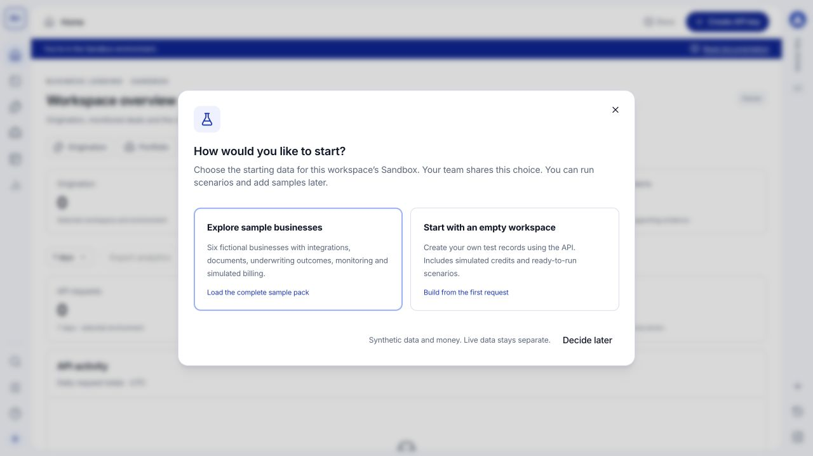

Start in the AMLOK Console's Sandbox so you can learn the workflow with fictional records and simulated credits. You can inspect a complete underwriting example before writing an API request.

## Before you start

Have your invitation email or the account you registered with AMLOK. Loading the complete sample pack requires an **Owner**. If you joined as a Developer or Analyst, your Owner can prepare the shared sample records for you.

<Steps>
  <Step title="Access your account">
    If you received an invitation, open its account setup link and follow the instructions. If you already have an account, sign in using the invited email. Otherwise, use **Sign up** at [console.amlok.io](https://console.amlok.io/) and complete account verification and organization setup when prompted.

    See [account access](/console/account-access) for the two paths.
  </Step>
  <Step title="Check your workspace and environment">
    Open the workspace profile at the top of the left navigation. Confirm the organization and workspace name, and select **Sandbox**. A workspace can contain both Sandbox and Live, but Live access requires activation.
  </Step>
  <Step title="Choose your starting data">
    Select **Explore sample businesses** for a complete guided dataset, or **Start with an empty workspace** to create your own test records through the API. This is a shared workspace choice, not a separate choice for each teammate.

    **Decide later** dismisses the prompt for the current browser tab without completing setup. Until a choice is recorded, the prompt can appear again in a later session.

    <Frame caption="The first-use choice. Load fictional businesses to explore complete examples, or start with your own test submissions.">
      
    </Frame>
  </Step>
  <Step title="Wait for preparation to finish">
    If you choose samples, keep the preparation dialog open while it creates the businesses and related records. The progress messages continue until setup completes. **Your workspace is ready** confirms completion and the dialog closes.

    If the connection is interrupted, refresh and use **Check again** when offered. If setup needs attention, open the scenario tools to inspect its run. Do not repeatedly start fresh runs to recover an interrupted setup.
  </Step>
  <Step title="Open your first result">
    Open **Origination**, select **Completed**, and open a borrower row. In **Overview**, inspect the risk package. Review **Documents** and **Integrations** for supporting evidence. Owners and Developers can also inspect **API request** and **API response**. The [Origination guide](/console/origination) explains each tab. Close the drawer to return to the same table.

    A completed request can produce a within-policy, outside-policy or review-required result. Read the recommendation and evidence, not just the processing status.
  </Step>
  <Step title="Choose your next task">
    Risk teams can open **Portfolio** and review **Notifications & flags** for a monitored deal. Developers can open **Dev Tools > Data Lookup**, then run an example in **Sandbox scenarios**. Owners can invite teammates and review simulated billing.
  </Step>
</Steps>

## You are ready to continue when

- You can identify your selected organization, workspace and environment.
- You can open a record and distinguish its processing status from its underwriting recommendation.
- You know whether you are using sample records or creating your own test data.
- You know which Owner to contact for access or Live activation.

Sandbox never charges your card or debits a bank account. Its balance, funding and consumption demonstrate how financial records relate. See [Sandbox setup](/sandbox/getting-started) and [simulated billing](/sandbox/simulated-billing) for details.
