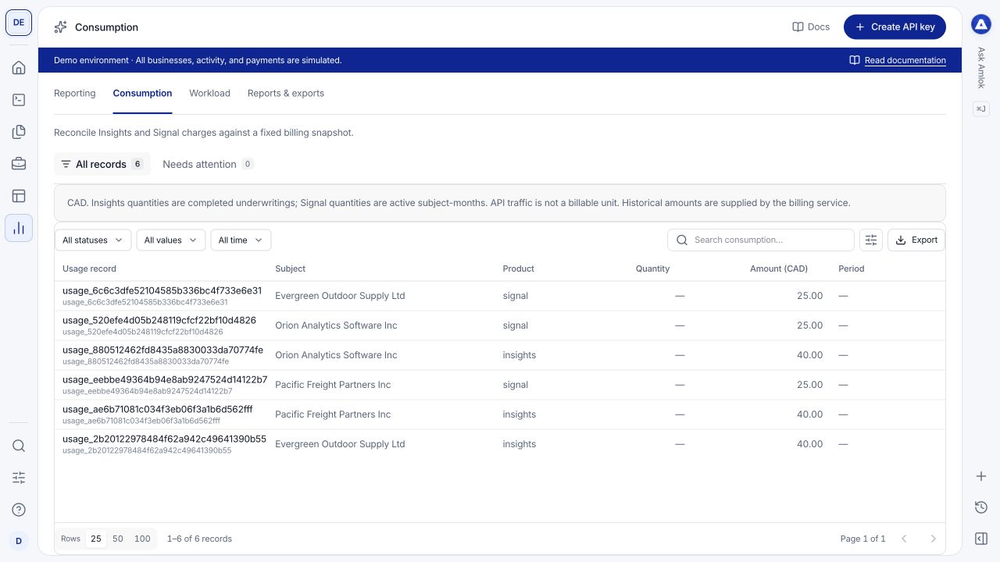

**Reporting** separates operational activity from billing. Use the view that answers your question instead of treating request volume, processing counts and product consumption as interchangeable.

## Watch a short walkthrough

This 64-second walkthrough covers reviewing API activity, historical consumption and workload, then downloading a generated report. It was recorded on [demo.amlok.io](https://demo.amlok.io) with fictional data. It uses on-screen instructions and has no audio. Use full screen to read the controls. The written guidance below explains the same workflow.

<video controls playsInline preload="metadata" poster="/images/console/reporting-exports.png" aria-label="Reporting and exports walkthrough recorded in the demo environment" width="100%">
  <source src="/videos/console/reporting-exports.mp4" type="video/mp4" />
  Your browser does not support embedded video. <a href="/videos/console/reporting-exports.mp4">Download the walkthrough</a>.
</video>

[Download the video](/videos/console/reporting-exports.mp4) · [Download captions (WebVTT)](https://raw.githubusercontent.com/amloktech/docs/main/videos/console/reporting-exports.vtt)

The clip downloads three separate files: an analytics summary, a generated risk package and its export-record metadata. All activity and amounts shown are simulated. The written guidance below explains how to choose the right export.

## Choose the right report

| View | Use it for |
| --- | --- |
| **Reporting** | Daily API traffic and errors. Use request logs to investigate response times, individual endpoints and keys. |
| **Consumption** | Insights and Signal quantities and historical charges. Owner access is required. |
| **Workload** | Processing counts and agreed workload limits, separate from charges. |
| **Reports & exports** | Available published reports and export records. |

Confirm the workspace, environment and reporting period. Filters on one view do not change the meaning or time window of a different report.

## Review consumption

Open **Consumption** and inspect the product, subject, quantity, amount and period. Select a row to inspect its detail and related identifiers.

<Frame caption="Consumption records describe product usage and charges. They are separate from raw API traffic.">
  
</Frame>

Insights quantities represent completed underwritings. Signal quantities represent active subject-months under the billing contract. API calls and workload counts are not additional financial units. Use the recorded historical amount and billing context rather than recalculating an old charge from today's price.

To reconcile money, compare these records with **Billing**, **Funding history** and **Statements**. See the [billing guide](/console/billing).

## Investigate operational changes

If errors or response time increase, open [request logs](/console/request-logs) and narrow the time range, endpoint or key to find specific examples. If processing counts approach an agreed workload limit, review **Workload** and the applicable API capacity information.

Check the denominator and period before comparing charts. A count of requests includes different operations from a count of completed underwritings; a processing failure may appear in operational activity without becoming a completed billable underwriting.

## Export records

The table's **Export** action downloads the filtered records currently available to that console collection. It is useful for a focused review, but is not a guarantee that you have exported every record in a large workspace.

For complete programmatic retrieval, use the [large-results workflow](/api-reference/large-results), pagination or the appropriate API export. In **Reports & exports**, open a completed record and select **Download artifact** to retrieve the generated file. For a multipart artifact, download each part in order. **Export record JSON** saves the report metadata separately. An export that is still processing is not ready for download. Once an artifact expires, create a new export through the API.

Billing exports require Owner access. Statement exports also appear in **Statements** as a frozen, provisional snapshot of the requested period; generating a report does not close the billing period or charge the account.

Respect the selected workspace, environment and your authorization when sharing exported data. Use [enterprise operation](/api-reference/enterprise-operation) and [workload reporting](/api-reference/workload-reporting) for automated collection at volume.
