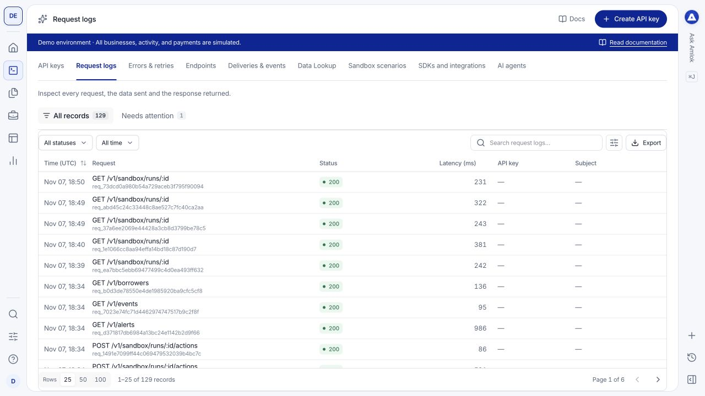
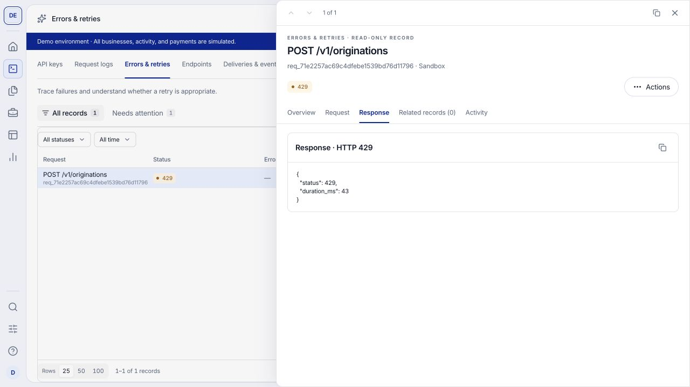

Use **Dev Tools > Request logs** to inspect calls made to the product API. Use **Errors & retries** to focus on failed requests. These views are available to Owners and Developers.

## Find the request

Filter by status, request details and time, or search for the identifier you recorded in your client. Confirm the workspace and environment first. Times marked **UTC** use UTC rather than your browser's local time.

<Frame caption="Request logs show method, path, status and timing so you can identify the call to inspect.">
  
</Frame>

Select a row to open its drawer. Use the available tabs to inspect the overview, request, response, related records and activity. Payloads and metadata can be redacted; the log is not a place to recover secrets.

## Read the response before retrying

| Status or situation | Next step |
| --- | --- |
| `202` accepted | Follow the returned operation or record. Acceptance is not completion. |
| `400` or validation error | Check the identified field and schema in Data Lookup. Correct the input before retrying. |
| `401` or `403` | Check the key, expiration, environment, scope and access. |
| `404` | Check the identifier and whether it belongs to the selected workspace and environment. |
| `409` | Read the conflict reason, including idempotency or resource-state conflicts. |
| `429` | Respect the returned retry guidance and reduce request pressure. |
| Timeout or server error | Use the recovery and idempotency contract to determine whether the original request was accepted. |

<Frame caption="The response view shows the returned error payload. Use the error code and request identifier in your investigation.">
  
</Frame>

For a retry of the same write, retain the same idempotency key and payload as required by the [idempotency contract](/api-reference/idempotency). Do not repeatedly create new originations to recover from a lost response.

## Keep a useful trace

Record the AMLOK request identifier, your caller request identifier when supplied, the UTC time, method, endpoint and related record or job identifier. Preserve the error code and response status. These make it possible to connect client activity with processing and later events.

Opening a request does not retry it. Outbound webhook attempts appear separately in [Deliveries & events](/console/webhooks), because a successful API request and a successful event delivery are different operations.

See [request recovery](/api-reference/request-recovery), [errors](/api-reference/errors) and [rate limits](/api-reference/rate-limits) for exact retry behavior.
