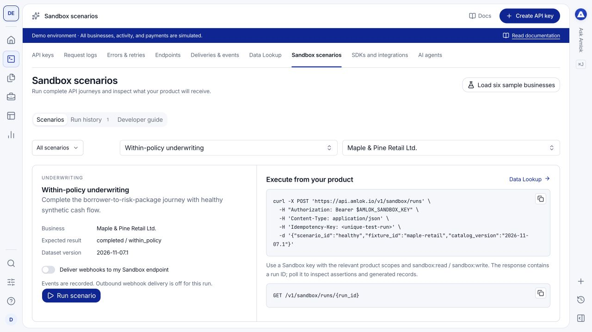

Use **Dev Tools > Sandbox scenarios** to exercise known underwriting, monitoring and operational outcomes. Scenarios create test records you can inspect in the console and retrieve through the API.

## Watch a short walkthrough

This 62-second walkthrough covers running a fictional underwriting scenario, checking its outcome and inspecting the recorded API responses. It was recorded on [demo.amlok.io](https://demo.amlok.io) with fictional data. It uses on-screen instructions and has no audio. Use full screen to read the controls. The written guidance below explains the same workflow.

<video controls playsInline preload="metadata" poster="/images/console/sandbox-scenarios.png" aria-label="Sandbox scenario walkthrough recorded in the demo environment" width="100%">
  <source src="/videos/console/sandbox-scenarios.mp4" type="video/mp4" />
  Your browser does not support embedded video. <a href="/videos/console/sandbox-scenarios.mp4">Download the walkthrough</a>.
</video>

[Download the video](/videos/console/sandbox-scenarios.mp4) · [Download captions (WebVTT)](https://raw.githubusercontent.com/amloktech/docs/main/videos/console/sandbox-scenarios.vtt)

The example leaves webhook delivery off and shortens the wait for processing. The demonstration site suppresses outbound webhooks. Its API host and fictional business display names are specific to the demo; use `https://api.amlok.io` with your own workspace Sandbox key when following the API examples.

## Prepare your workspace

At first use, choose sample businesses or an empty workspace. The choice is shared by everyone using that workspace. You can load the sample businesses later from the scenario tools; choosing empty does not prevent future testing.

The sample pack contains **six fictional businesses** with associated application, source, underwriting, monitoring and system records. See [businesses and scenarios](/sandbox/businesses-and-scenarios) for the fixtures and expected outcomes, and [sample data and documents](/sandbox/sample-package) for their linked records and downloadable PDFs. An Owner loads the complete pack. Owners and Developers use the scenario tools; financial scenarios require an Owner. Analysts review the resulting product records.

## Run a case

<Steps>
  <Step title="Select a scenario and business">
    Open the **Scenarios** tab. Choose the category and scenario, then select a compatible fictional business. Read the expected result before running it.
  </Step>
  <Step title="Review delivery options">
    Keep event delivery as record-only unless you intend to test an eligible endpoint you control. The separate demo deployment does not send external webhooks.
  </Step>
  <Step title="Run and wait for completion">
    Select **Run scenario**. Follow its status and steps rather than assuming the initial accepted response means the run has finished.
  </Step>
  <Step title="Inspect the generated records">
    Open **Run history** and select the run. Inspect its outcome, step details and linked records. Follow the generated origination, monitoring event, request log or billing record into the corresponding console area.
  </Step>
</Steps>

<Frame caption="Choose a predictable result, inspect what the case exercises and run it against a fictional business.">
  
</Frame>

Use the **Developer guide** and available request examples to reproduce the workflow from your own integration. An Owner creates a **Sandbox testing** API key for the complete sample pack and financial scenarios; **All products** supports nonfinancial product scenarios. The Sandbox testing profile is available only in Sandbox. [Data Lookup](/console/data-lookup) explains the fields; the [API Sandbox journeys](/api-reference/sandbox-journeys) document the execution contract.

## Build a useful test sequence

| Case | What your application should handle |
| --- | --- |
| Within-policy underwriting | A completed result, risk dimensions and evidence. |
| Outside-policy or review-required result | A completed assessment whose recommendation needs different handling. |
| Missing information or disconnected source | An actionable condition without inventing missing values. |
| Monitoring change | Event ingestion, related evidence and downstream investigation. |
| Request or webhook failure | Error display, idempotency, retries and deduplication. |
| Funding and consumption | Simulated credits, debits, payment outcomes and reconciliation. |

## Repeat without confusing your records

A fresh run creates its own records and identifiers; it is not a workspace reset. Preserve run and record IDs when comparing results. Use filters to distinguish earlier runs from the current case.

Sandbox credits and payment records are simulated. There is no real charge, bank debit, refund or transfer. API authentication, validation and record inspection still give your developers a realistic integration workflow. See [simulated billing](/sandbox/simulated-billing) and [Sandbox versus Live](/console/environments).
