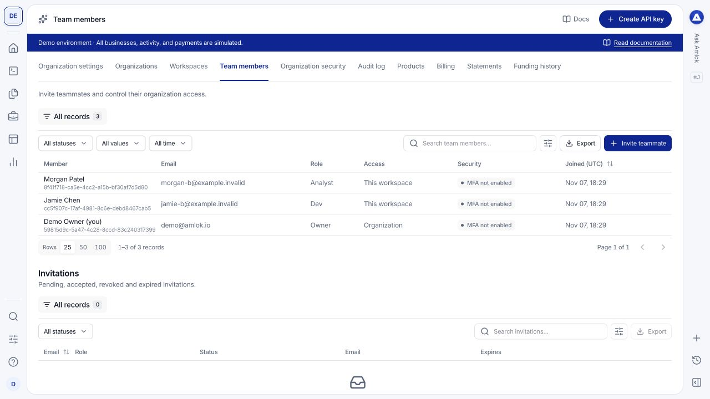

Owners manage access in **Workspace settings > Team members**. New invitations grant access only to the selected workspace. Existing organization members retain their organization-wide access, which is identified separately in the table.

## Choose a role

| Role | Typical access |
| --- | --- |
| **Owner** | Organization and workspace administration, team, billing, developer tools and product records. |
| **Dev** | Integration configuration, developer tools, Sandbox development and product record review. |
| **Analyst** | Product record review and permitted reporting, without integration or billing administration. |

All roles review product records as read-only in the console. The role does not add an approval button or let a user edit an underwriting result. API keys have their own scopes in addition to user permissions.

## Invite a teammate

<Steps>
  <Step title="Select the workspace">
    Check its name in the profile menu. This is the workspace the invitation will grant access to.
  </Step>
  <Step title="Enter the invitation">
    Open **Team members**, select **Invite teammate**, and enter the teammate's email. Choose **Dev** or **Analyst**, then complete the requested confirmation.
  </Step>
  <Step title="Have the teammate accept">
    The recipient receives a branded email with a secure setup link that expires in 48 hours. A new user sets up their account; an existing user signs in with the invited email and accepts access.
  </Step>
  <Step title="Verify membership">
    Review **Invitations** for the invitation state and **Team members** for accepted access. Confirm the role and the **Access** column.
  </Step>
</Steps>

<Frame caption="The Access column distinguishes organization membership from membership limited to this workspace.">
  
</Frame>

## Manage invitations

Inspect an invitation's status, delivery information and expiration. Resend an invitation when needed; the new link replaces the previous one. Revoke a pending invitation if access is no longer required.

If the recipient cannot find the email, confirm the address and ask them to check spam or filtering. An expired or revoked link should be replaced by a new invitation. See [account access](/console/account-access) for acceptance issues.

## Change or remove access

Open the member's record and use the available **Change role** or **Remove** action. Read the scope in the confirmation:

- A **workspace** membership change applies here.
- An **organization** membership change affects access across that organization.

Removing membership does not delete the person's account. The last organization Owner cannot be removed. Review workspace memberships when a person changes teams; do not assume removing access from one workspace removes independent access elsewhere.

Use [organization security](/console/security) to require MFA and [Audit log](/console/workspaces) to review recorded access changes.
