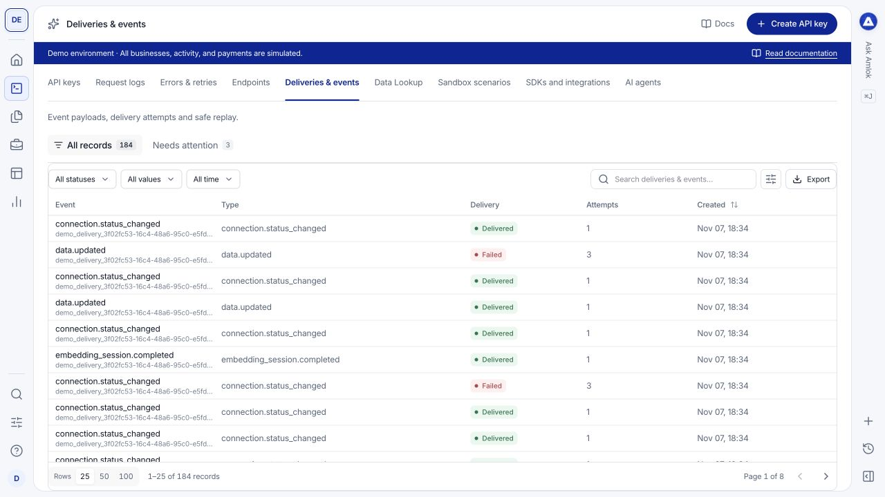

Webhooks notify your integration about underwriting, monitoring and other subscribed events. Owners and Developers manage destinations in **Dev Tools > Endpoints** and inspect outgoing activity in **Deliveries & events**.

## Watch a short walkthrough

This 46-second walkthrough covers endpoint configuration, event subscriptions and inspecting a recorded event. It was recorded on [demo.amlok.io](https://demo.amlok.io) with fictional data. It uses on-screen instructions and has no audio. Use full screen to read the controls. The written guidance below explains the same workflow.

<video controls playsInline preload="metadata" poster="/images/console/webhooks.png" aria-label="Webhook endpoint and event inspection walkthrough recorded in the demo environment" width="100%">
  <source src="/videos/console/webhooks.mp4" type="video/mp4" />
  Your browser does not support embedded video. <a href="/videos/console/webhooks.mp4">Download the walkthrough</a>.
</video>

[Download the video](/videos/console/webhooks.mp4) · [Download captions (WebVTT)](https://raw.githubusercontent.com/amloktech/docs/main/videos/console/webhooks.vtt)

<Note>
  The demo endpoints use disabled `example.invalid` placeholders. Supply a public HTTPS destination that your team controls when setting up your own receiver. This clip reviews configuration and cancels editing without saving. The demo site suppresses outbound delivery, so this is not a live delivery or signature-verification test.
</Note>

## Register an endpoint

1. Select the correct workspace and environment.
2. Open **Endpoints** and select **Add webhook**.
3. Enter a recognizable name and a public HTTPS hostname on port 443 controlled by your team. Use the final URL; redirects, private addresses and URL credentials are not supported.
4. Select individual event subscriptions, or use **Select all** / **Clear**. Saving requires at least one event. Editing preserves the selected subset. Billing events are available only to Owners. Complete the requested identity confirmation.
5. Store the signing secret securely when it is shown, and implement signature verification in your receiver.

Use the endpoint drawer to inspect or edit its configuration. An endpoint being enabled does not prove that your server has received an event. Confirm delivery with a controlled test.

## Inspect a delivery

Open **Deliveries & events** and filter or search for the event associated with your record. Select a row to inspect the available event payload, destination, status, response and attempt details. **Overview** shows the event payload and delivery summary. **Raw data** shows the stored representation; **Related records** connects it to the associated business records. A row marked **Recorded** can have no delivery attempts.

<Frame caption="Use event and delivery records to follow notifications independently of incoming API requests.">
  
</Frame>

Keep these identifiers separate:

| Identifier | Purpose |
| --- | --- |
| Event ID | Identifies the business event and supports deduplication. |
| Endpoint ID | Identifies the configured destination. |
| Delivery or attempt ID | Identifies an attempt to send the event. |
| Related record ID | Connects the event to an origination, monitored deal or other product record. |

## Troubleshoot missing notifications

- **No event record:** check that the product action completed and that the expected event type applies. A successful submission can still be processing.
- **No matching destination:** check the endpoint's environment, status and event subscriptions.
- **Failed delivery:** inspect the receiver's response, HTTPS availability and signature handling.
- **Repeated event:** deduplicate by event identity and make your handler safe to run again.
- **Out-of-order delivery:** reconcile with the current API record instead of treating arrival order as business order.

Implement signature verification against the original request body, acknowledge promptly and process asynchronously. Follow [webhook operations](/api-reference/webhook-operations) for retry, replay and secret-handling rules, and the [event catalog](/api-reference/event-catalog) for payload meanings. Do not assume opening a delivery in the console replays it.

## Test safely in Sandbox

Sandbox scenarios record example events and deliveries. Outbound test delivery requires the scenario's explicit delivery option and an eligible endpoint you control. The separate demonstration site suppresses outbound delivery; its records illustrate the experience without contacting external systems.

Start with a successful receiver, then test failure, duplicate and retry handling. See [Sandbox scenarios](/console/sandbox) and the [webhook integration guide](/api-reference/webhooks).

## Update and rotate

Choose **Edit endpoint** to change the URL, exact subscriptions or enabled status. Disabling stops future/queued sends once the worker checks the endpoint; a request already in flight can finish. Re-enabling does not backfill events recorded while the endpoint was disabled. Replay retained events explicitly if needed.

Choose **Rotate signing secret** in the endpoint actions. Copy the new secret once and update your receiver within the 24-hour overlap. The drawer displays the previous-secret expiry, retry delays, timeout and replay window. Rotation needs identity confirmation, and a second rotation is blocked during the overlap.

In **Deliveries & events**, a row marked **Recorded** is a business event, not proof of delivery. Attempt rows show the endpoint ID, HTTP result, duration, safe error code and scheduled next attempt when present. `exhausted` means no automatic retry remains. Historical/demo records may have fewer diagnostics. See the [complete error catalog](/api-reference/errors).

Replay is an authenticated API action using `POST /v1/webhook-replays`, an existing event and enabled endpoint ID, and an idempotency key. Use Data Lookup for the request example. Repeating a replay with the same key returns the original receipt; a new key intentionally requests a new delivery. This does not charge for or rerun the original business action.
