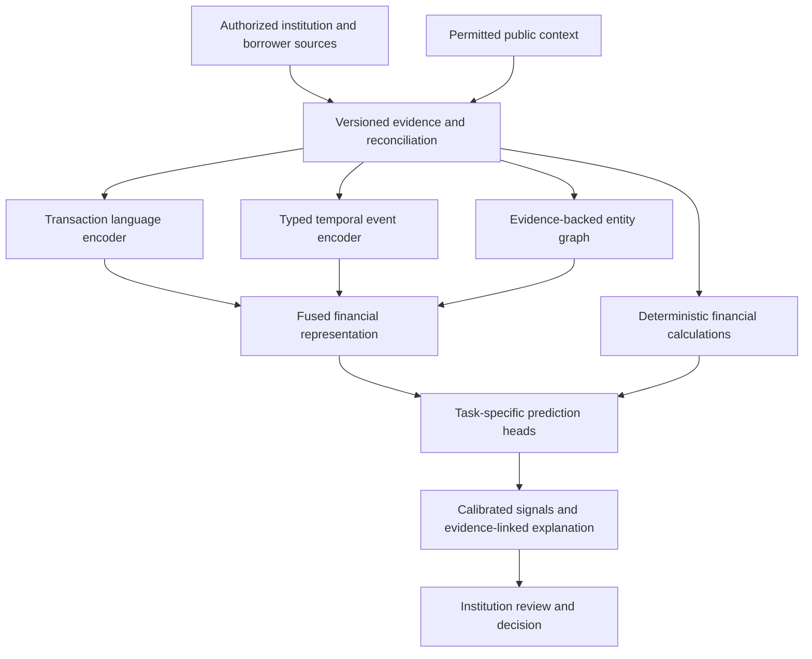

The proposed AMLOK system uses different components for different scientific tasks. A foundation model claim would require evidence of reusable pretraining and transfer across multiple tasks. A transformer layer alone does not establish that claim, and a financial event encoder is not necessarily a generative LLM.

## Component contracts

| Component | Proposed role | Output and constraint |
| --- | --- | --- |
| Transaction language model | Parse descriptors and distinguish rail, intermediary, counterparty, and purpose | Typed candidates with evidence spans; unresolved identity is allowed. |
| Event encoder | Represent numeric, categorical, textual, and time fields | Preserve missingness, currency, magnitude, source, and availability. |
| History model | Learn temporal behavior over bounded historical evidence | Hierarchical windows and explicit coverage; no silent truncation of material history. |
| Graph component | Model supported entity and event relationships | Typed, time-scoped edges with provenance and uncertainty. |
| Feature engine | Calculate financial quantities | Versioned formulas with reconciled inputs; independent of narrative generation. |
| Task heads | Estimate defined outcomes or recognize changes | Separate calibration and validation for each product, cohort, and horizon. |
| Explanation model | Translate findings into readable evidence summaries | May explain calculations; cannot invent inputs, probabilities, or policy authority. |

## Representation design

Represent an event as source, type, time, and typed key-value fields. Use learned categorical embeddings, scale-aware numeric encoding, text representations, missing-value indicators, and time-gap/calendar features. Preserve raw values outside the embedding so every reported calculation remains reproducible.

For long histories, compare hierarchical event-to-day-to-month aggregation, retrieval of relevant evidence, and bounded local attention. Preserve material outliers, uncommon obligations, and original evidence references. Evaluate how each compression strategy affects low-frequency risk signals. The customer record allowance is not a model context length: 75,000 source records need not become 75,000 attention tokens.

## Proposed model families

Evaluate a compact specialist text model, an encoder-only event model, a graph-enhanced variant, and a general-purpose model with identical retrieval and calculator tools. Select a base checkpoint only after verifying its licence, language coverage, provenance, deployment constraints, and available compute. Record its exact revision and digest.

A pilot architecture search can vary event width, depth, windowing, and text adaptation. Treat configurations as candidates; do not invent production parameter counts, hardware inventories, training budgets, or achieved scaling laws. The [executed study](/research/synthetic-study) uses a deliberately small event encoder and is not the full architecture.

## What the design does not assume

A single latent vector cannot establish complete financial truth. Public sources do not reveal private transaction histories. Model scores need calibration and meaningful outcome definitions. A graph does not make correlations causal. An explanation can be fluent and still be wrong. These limitations determine the [evaluation design](/research/evaluation), rather than being deferred until deployment.
