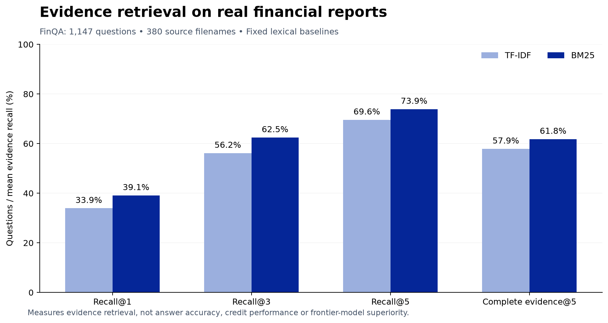

AMLOK completed two supervised baseline training runs on real SBA loan observations and two evidence-retrieval evaluations on real financial reports. These are separate tasks, with separate populations, outcome definitions and metrics.

## Supervised training on real loan records

The target is **SBA-reported charge-off within 36 calendar months of first disbursement**. It is narrower than all forms of borrower default. The cohort uses a deterministic approximately 10% record-hash sample of eligible funded-status observations approved in 2010-2016 from the complete September 30, 2026 source snapshot.

| Partition | Approval years | Loan observations | Positive outcomes | Normalized entity groups |
| --- | --- | ---: | ---: | ---: |
| Training | 2010-2013 | 19,135 | 291 | 18,837 |
| Validation | 2014 | 5,264 | 69 | 5,216 |
| Held-out evaluation | 2015-2016 | 11,996 | 210 | 11,822 |

Exact normalized-name/state groups seen in an earlier partition are excluded from later partitions. Unknown statuses, invalid dates, missing required amounts and charge-off records without outcome dates are excluded. Normalized names do not resolve every alias or beneficial-owner relationship.

### Features and fitting

Both models use log approval amount, guarantee fraction, initial interest rate, program, industry, business-age category and rate type. Numeric missingness is imputed from the training set, and categorical encodings are fitted on training data. Names, addresses, current lender, loan status, repayment dates, charge-off amount and current term are excluded from model inputs.

Logistic regression uses `C=1` and a maximum of 1,500 iterations. Histogram gradient boosting uses 120 iterations, 15 maximum leaf nodes, learning rate 0.08 and L2 regularization 1. Both use seed 42. The source snapshot does not establish that every predictor retained its original underwriting-time value; point-in-time review remains a material limitation.

### Measured outcomes

| Model | Evaluation AUROC | 95% grouped-bootstrap interval | Average precision | Brier score | Log loss |
| --- | ---: | --- | ---: | ---: | ---: |
| Logistic regression | 0.72284 | 0.68950 to 0.75072 | 0.04577 | 0.01706 | 0.08366 |
| Gradient-boosted trees | 0.71820 | 0.68480 to 0.74636 | 0.04267 | 0.01708 | 0.08437 |

Intervals use 300 bootstrap replicates grouped by normalized borrower identity, with seed 42. The paired AUROC difference (boosting minus logistic regression) has a 95% interval of -0.02406 to 0.01278. The run does not establish a reliable difference between these two methods. Evaluation outcome prevalence is 210 / 11,996, approximately 1.75%; interpret average precision against that prevalence.

These are retrospective research baselines for a US government-guaranteed lending population. Their probabilities are not validated lending scores for Canadian businesses or consumers. They do not evaluate a language model, private transaction streams or monitoring lead time.

Download the [baseline result manifest](/downloads/research/corpus/baseline-results.json) and [record-level evaluation predictions](/downloads/research/corpus/baseline-predictions.csv). The [model card](/research/model-card) gives the scientific scope and the [reproducibility guide](/research/reproducibility) describes the saved artifacts.

## Financial-document retrieval

AMLOK evaluated TF-IDF and BM25 on FinQA's held-out questions. Inputs are financial-report text and tables from the original dataset release. This study measures retrieval of annotated supporting evidence, not a language model's answer or a borrower's credit outcome.

## Study population and inputs

The acquired [FinQA release](https://github.com/czyssrs/FinQA) contains 6,251 training questions, 883 development questions and 1,147 test questions. This run uses all **1,147 test questions**, spanning **380 source filenames**. Each candidate set consists only of the supplied report's text sentences and table rows.

The ranking functions receive the question and source evidence. They do not receive the reference answer, reference program, gold evidence IDs or the dataset's existing retrieved/model-input fields. Gold evidence IDs enter only after ranking, for scoring. Every gold ID was checked against the constructed candidate set.

## Methods

**TF-IDF:** tokenize lowercase alphanumeric sequences, fit a document-local evidence vocabulary, normalize vectors and rank by query cosine similarity. No answer labels or learned supervised weights are used.

**BM25:** use the same tokenizer and source candidates, with `k1 = 1.5` and `b = 0.75`. Rank using document-local inverse document frequency and length normalization. Break ties deterministically by evidence ID. One configuration per method was run; the reported configuration was not tuned against the test labels.

Table rows are serialized with their column headings. The top 1, 3 and 5 candidates are evaluated. These implementation choices define this local comparison; the numbers are not directly interchangeable with another paper's differently constructed candidate set.

## Results

Recall is computed per question as retrieved gold evidence divided by all gold evidence, then averaged across questions. Complete-evidence rate is the share of questions for which every annotated evidence item is in the selected set.

| Method | Recall@1 | Recall@3 | Recall@5 | Complete evidence@5 |
| --- | ---: | ---: | ---: | ---: |
| TF-IDF | 33.93% | 56.18% | 69.60% | 57.89% |
| BM25 | 39.11% | 62.46% | 73.90% | 61.81% |

BM25 improves mean Recall@5 by **4.31 percentage points** over TF-IDF on this corpus. A paired bootstrap with 2,000 replicates, resampling source filenames while preserving their questions, gives a conditional 95% interval of **2.37 to 6.22 percentage points**. The resampling seed is `20261101`.

This interval describes uncertainty within this dataset and these fixed methods. It does not establish Canadian population generalization, institution-level robustness, causal business benefit or superiority over a frontier model.

## What the result establishes

The experiment establishes a reproducible retrieval floor for real financial-document reasoning. Even the better baseline retrieves all annotated evidence within five candidates for only 61.81% of questions. A downstream answer model can therefore fail because evidence was omitted before reasoning begins.

The result motivates separate retrieval and answer evaluations, layout-aware evidence construction, and inspection of incomplete evidence. It does not demonstrate that a proposed architecture fixes those failures. No AMLOK foundation-model or hosted GPT/Claude/Gemini predictions were produced in this run.

## Comparison status

| Component | Status | Evidence available |
| --- | --- | --- |
| TF-IDF and BM25 retrieval | Executed | Item-level rankings, metrics, source and script hashes. |
| Structured loan baselines | Trained and evaluated | Two fitted models, cohort IDs, predictions, metrics and grouped uncertainty. |
| Canadian source extraction | Inspected | Original documents, field mappings and OCR review records. |
| Financial QA generation | Not run | Task and scoring requirements specified. |
| Frontier language/vision models | Not run | Matched-evidence protocol specified. |
| AMLOK specialist language model | Not run | Architecture and training protocol specified; no completed production checkpoint in this package. |
| End-to-end underwriting and monitoring | Separate evaluation required | The SBA study measures reported charge-offs from structured loan fields, not the complete AMLOK workflow. |

## Reproduce and inspect

Download the [result manifest](/downloads/research/public-records/retrieval-results.json), [item-level retrieval predictions](/downloads/research/public-records/retrieval-predictions.json), [source analysis](/downloads/research/public-records/source-analysis.json) and [acquisition manifest](/downloads/research/public-records/acquisition-manifest.json). The [reproducibility guide](/research/reproducibility) describes acquisition, execution and validation.

The saved test-file SHA-256 is `831dbfb2e785dbc227f895ce3f24046433467aec67b09db2bd6ac7692a8a30dc`. Preserve that snapshot when reproducing this result. Re-acquiring a changed upstream file creates a new dataset version, not an exact reproduction.
