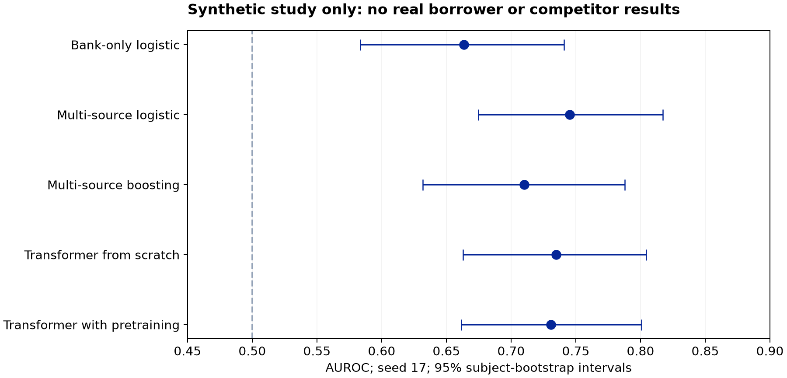
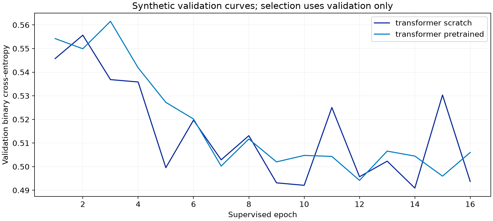

This page reports an actual local experiment on generated data. It does not report a trained production LLM, Canadian borrower performance, or a comparison against commercial systems. The public-data descriptive study is documented separately under [Canadian data](/research/canadian-data).

<Warning>Every subject, financial observation, and outcome in this training study is synthetic. The target is authored future liquidity stress, not observed default. Do not use these probabilities or scores for lending.</Warning>

## Study design

The fixed-seed generator creates 1,200 fictional subjects with 12 monthly summaries across two bank channels and five business-system channels: processor sales, commerce orders, accounting margin, overdue invoices, and payroll. This yields 100,800 source-month observations. They are not raw transaction records. Latent trend, debt burden, margin, and overdue share determine a probabilistic toy stress label. The equation is in the source code; it was not estimated from Canadian borrowers.

| Partition | Subjects | Generated observations | Positive labels | Prevalence |
| --- | ---: | ---: | ---: | ---: |
| Train | 720 | 60,480 | 208 | 0.289 |
| Validation | 240 | 20,160 | 57 | 0.237 |
| Test | 240 | 20,160 | 57 | 0.237 |

Subjects are disjoint. Training, validation, and test have nominal observation years 2023, 2024, and 2025 and different synthetic institution identifiers. The generator uses the same stochastic mechanism across partitions, so this is **not** evidence of robustness to real temporal or institutional shift. No future observations or outcome labels enter input features.

## Models and selection

Logistic models use means, last values, and recent-minus-early differences. The bank-only model receives two channels; the multi-source models receive all seven. Boosting uses the same aggregate features. The transformer receives 84 source-month tokens with numeric value, source identity, and month embeddings. It has two layers, width 32, four attention heads, and mean pooling. It is an event encoder, not a text-generating LLM.

The model contains **17,858 parameters** including reconstruction and classification heads. Pretraining masks 20% of numeric tokens for four epochs. Both variants receive 16 supervised epochs with AdamW, learning rate 0.001, weight decay 0.01, batch size 72, gradient clipping at 1, and no dropout. The best epoch is selected using validation loss. Normalization uses only training data. Seeds are 17, 29, and 43. No hyperparameter search or post-hoc selection of the best test seed was performed.

The pretraining arm receives additional optimization steps. This experiment does not isolate pretraining from an equal-compute supervised control. No probability recalibration is applied; this study uses validation for checkpoint selection and has no separate calibration partition.

## Held-out results

The table reports every run. AP means average precision and depends on the synthetic test prevalence. Lower Brier score and log loss are better. Seed 17 was designated as the display run; the chart does not select the best-performing seed.

| Model | Seed | AUROC | AP | Brier | Log loss |
| --- | ---: | ---: | ---: | ---: | ---: |
| Bank-only logistic | 17 | 0.663 | 0.399 | 0.172 | 0.524 |
| Multi-source logistic | 17 | 0.745 | 0.500 | 0.158 | 0.483 |
| Multi-source boosting | 17 | 0.710 | 0.457 | 0.167 | 0.523 |
| Transformer from scratch | 17 | 0.735 | 0.458 | 0.161 | 0.490 |
| Transformer from scratch | 29 | 0.734 | 0.467 | 0.162 | 0.491 |
| Transformer from scratch | 43 | 0.735 | 0.445 | 0.161 | 0.489 |
| Transformer with pretraining | 17 | 0.731 | 0.449 | 0.162 | 0.491 |
| Transformer with pretraining | 29 | 0.718 | 0.442 | 0.166 | 0.502 |
| Transformer with pretraining | 43 | 0.734 | 0.436 | 0.162 | 0.492 |

## Paired comparisons

| Contrast, seed 17 | AUROC difference | Paired 95% interval |
| --- | ---: | --- |
| multisource logistic minus bank logistic | +0.082 | [+0.005, +0.164] |
| transformer pretrained minus transformer scratch | -0.004 | [-0.019, +0.012] |

Intervals use 500 subject-bootstrap replicates on the same 240 synthetic test subjects. They capture resampling uncertainty conditional on this toy dataset and fitted model, not Canadian population uncertainty, synthetic-generator uncertainty, or variability across institutions. The three training seeds are not three independent test cohorts. These are exploratory engineering results, not a pre-registered real-world efficacy study.

## Interpretation

The multi-source logistic baseline has the strongest point estimates in this run. Adding sources helps in a toy world deliberately constructed to contain information in those sources. That is a pipeline demonstration, not empirical proof that borrower-permissioned integrations reduce real credit losses.

The pretrained transformer does not improve on the from-scratch transformer or the multi-source logistic baseline here. The negative result is retained. It argues for testing strong simple baselines and for separating information gains from model-complexity claims. It does not show that pretraining is ineffective at realistic scale.

## Unmeasured capabilities

This study does not evaluate bilingual descriptors, entity resolution, graph learning, raw settlements, consumer affordability, loan outcomes, fairness, production monitoring, adversarial documents, or hosted frontier models. Its monthly aggregates omit the hard record-linkage problem. It cannot validate the proposed full architecture.

## Reproduction

See the [reproducibility guide](/research/reproducibility), [complete result manifest](/downloads/research/synthetic-results.json), and [paired comparisons](/downloads/research/paired-comparisons.json). The manifest records the actual environment, script digest, data digest, parameter count, epoch losses, fitting times, and execution timestamp. Timings describe this local CPU experiment only.
