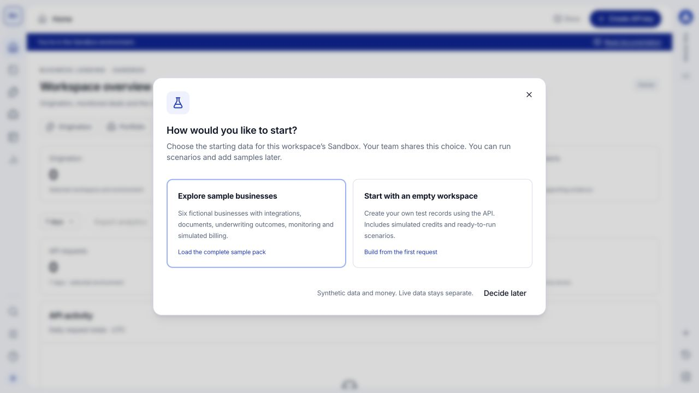

Open your AMLOK workspace and select **Sandbox**. On first use, the setup modal asks how you want to start. This choice controls the starting data for the workspace's Sandbox and is shared with your teammates.

<Frame caption="First-use setup: load six fictional businesses or start with your own test records. Both choices stay inside Sandbox.">
  
</Frame>

New to the interface? Follow [Console first steps](/console/quickstart) for account access, workspace selection and your first result.

## Choose the right starting point

| Option | What happens | Choose it when |
| --- | --- | --- |
| **Explore sample businesses** | Loads six fictional businesses with integrations, documents, underwriting outcomes, monitoring and simulated billing. | You want to explore complete records before writing requests. |
| **Start with an empty workspace** | Adds no sample business pack. You create your own test records through the API, with simulated credits and scenarios available. | You want to build your integration from its first request. |
| **Decide later** | Dismisses the choice in the current browser tab without starting sample preparation. | You want to look around before choosing. |

<Note>
**Empty means no sample business records, not no capabilities.** You still have API tools, scenarios and CAD 5,000.00 in simulated starting credits. Choosing empty in this **first-use modal** does not delete existing records. You can load sample businesses later.
</Note>

An **Owner** can load the complete pack, including financial scenarios. An **Owner** or **Developer** can choose an empty workspace. Developers can execute nonfinancial scenarios with the required permissions; Analysts cannot execute scenarios. If **Explore sample businesses** is disabled for you, ask a workspace Owner to load the pack.

## Load and explore the sample pack

<Steps>
  <Step title="Choose Explore sample businesses">
    The setup modal starts preparing records for your selected Sandbox. Your teammates share the same setup choice.
  </Step>
  <Step title="Wait for your workspace to be ready">
    The progress modal cycles through preparation messages while businesses, use cases and records are created. It reaches completion only after preparation finishes and the records refresh. You then see **Your workspace is ready**, and the modal closes automatically.

    Refreshing the page can resume the progress view. If setup needs attention, use **Open scenario tools** to inspect the run; if the connection was interrupted, use **Check again**. Records already created are preserved.
  </Step>
  <Step title="Explore generated records">
    Open **Origination** to inspect applications and underwriting outcomes, or **Portfolio** for completed assessments with monitoring. Click a record to open its detail drawer and follow its associated documents and integrations.

    In **Dev Tools**, inspect **Request logs**, **Deliveries & events**, and **Sandbox scenarios**. In **Billing**, inspect the simulated balance, funding and consumption. Open **Statements** for the generated month-to-date snapshot, and **Reports & exports** to download its file. These are simulated records; generating them does not charge the account.
  </Step>
  <Step title="Run a scenario from your product">
    Open **Dev Tools > Sandbox scenarios**, select a category, scenario and business, and review the expected result. Use **Run scenario** or copy the request example into your server-side integration. Open **Data Lookup** for field types, payload examples and explanations.
  </Step>
</Steps>

## Start with your own test records

Choose **Start with an empty workspace**, [create a Sandbox API key](/console/api-keys), and follow the [API quickstart](/api-reference/quickstart). For a complete test including sample-pack setup and financial scenarios, an Owner selects **Sandbox testing**. Select **All products** to test underwriting and monitoring without billing permission, or choose a narrower profile for a single service. The default **Read product data** profile cannot create records or execute scenarios. Use fictional application information and test documents. Use `https://api.amlok.io` as `AMLOK_API_BASE_URL`, without `/v1`. Your Sandbox key selects the workspace environment. Do not use the staging API for a Sandbox workspace created in the customer Console. See [URLs and environments](/api-reference/environments).

Use [Sandbox scenarios](/api-reference/sandbox-journeys) when you need deterministic provider data or a specific outcome. An empty workspace does not connect real institutions or populate business data automatically.

You can return to **Dev Tools > Sandbox scenarios** at any time. **Load six sample businesses** adds the complete pack. **Repeat with fresh records** creates another run and preserves earlier records and ledger history; neither action resets your workspace.

## Switch between samples and a clean Sandbox

An Owner opens **Workspaces > Sandbox data** and chooses **Start empty** or **Load fresh sample data**. Unlike the first-use choice or a normal scenario run, both options clear all existing Sandbox test records before applying the new choice. They also restart simulated billing with CAD 5,000.00 in starting credits; sample activity then records its own funding and consumption.

Type the workspace name and complete the requested identity confirmation. Loading samples uses the preparation modal until the actual setup completes. Work with your teammates to stop active requests and processing before resetting. See [what is removed and what is kept](/console/workspaces#reset-sandbox-data).

The choice remains shared by the workspace and the first-use modal stays dismissed. You can repeat either reset later. Existing API keys and configuration are kept, while old record IDs, download links and pagination cursors become invalid.

<Tip>
Owners and Developers can create a separate test workspace when you need an independent dataset. Within one workspace, keep the returned run and resource IDs so your team can identify which records belong to each test.
</Tip>

Continue with [businesses and scenarios](/sandbox/businesses-and-scenarios) or [simulated billing](/sandbox/simulated-billing).
